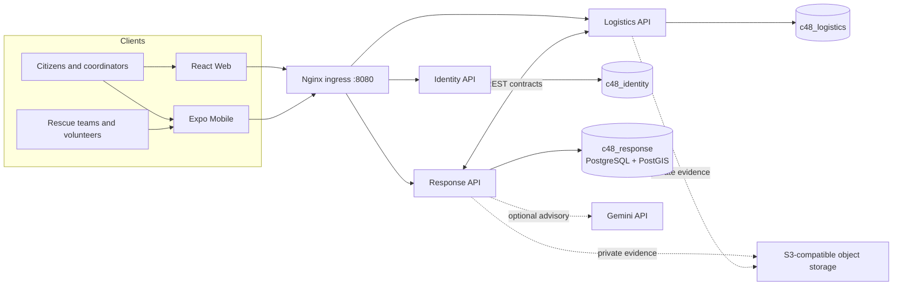

# Reliva — Emergency Response and Disaster Relief Management System

> Vietnamese project title: **Hệ thống quản lý ứng phó khẩn cấp và cứu trợ thiên tai**

Reliva is an academic capstone project for coordinating disaster reports, rescue missions, volunteer teams, and in-kind relief operations. It provides Vietnamese-language Web and Mobile workflows for affected residents, rescue teams, coordinators, operations staff, and administrators.

> **Project status:** academic prototype. The system and its risk-assessment rules have not been validated for real-world emergency dispatch. Coordinators retain authority over verification, official priority, and team assignment. Use synthetic data for demonstrations.

## Contents

- [Project scope](#project-scope)
- [Architecture](#architecture)
- [Technology stack](#technology-stack)
- [Repository layout](#repository-layout)
- [Quick start](#quick-start)
- [Configuration](#configuration)
- [Local endpoints](#local-endpoints)
- [Development and verification](#development-and-verification)
- [Security and operational limits](#security-and-operational-limits)
- [Project documentation](#project-documentation)
- [License](#license)

## Project scope

Reliva connects the following roles:

| Role | Main workflows |
|---|---|
| Citizen / reporter | Submit an SOS or assistance report, share a location, provide household and incident details, and follow progress. |
| Volunteer / rescue team | Maintain team availability and location, review missions, report progress, and record outcomes. |
| Coordinator | Review and verify reports, inspect risk factors, compare teams, assign missions, and follow operational history. |
| Operations staff | Manage in-kind donation drives, warehouses, stock, vehicles, relief points, and distributions. |
| Administrator | Manage accounts, organizations, memberships, permissions, and operational records. |

The current implementation includes these capability areas:

- Email one-time-password registration and Google ID-token sign-in, subject to provider configuration.
- GPS-based SOS intake with reported danger, rescue and supply needs, and household counts for older adults, children, and other affected people.
- Reporter updates, verification, coordinator review queues, request timelines, and scoped tracking.
- Server-side deterministic risk factors and balanced team suggestions that consider eligibility, position freshness, distance, and recent workload. Assignment remains a coordinator action.
- Mission progress and team history for operational review.
- In-kind donation intake and review, inventory and fulfillment workflows, and distribution records.
- Optional Gemini narrative extraction into structured JSON for coordinator review. The provider call limit is capped locally at 500 calls per `America/Los_Angeles` calendar date.

The implementation status and remaining acceptance evidence are maintained in the [backend implementation guide](docs/backend/README.md).

## Architecture

The three NestJS services own separate databases and communicate through versioned REST APIs. Nginx serves the Web application and routes API traffic through the same local origin.



In the default Compose setup, Web is available at `/` and the APIs use `/api/v1/identity`, `/api/v1/response`, and `/api/v1/logistics` on port `8080`. PostgreSQL hosts three service-owned databases with separate service credentials. The optional AI worker belongs to Response; it has no authority to change a request priority or dispatch a team.

## Technology stack

| Area | Technology |
|---|---|
| Backend APIs | NestJS, TypeScript, TypeORM, REST/JSON |
| Identity | Email OTP, Google ID-token verification, role- and region-scoped access |
| Database | PostgreSQL with PostGIS for spatial queries |
| Web | React, TypeScript, Vite, Nginx static image |
| Mobile | React Native, Expo, TypeScript |
| Ingress and local deployment | Nginx and Docker Compose |
| AI-assisted extraction | Optional server-side Gemini API integration with schema-constrained JSON output |
| File evidence | Private S3-compatible object-storage interface |

## Repository layout

```text
backend/
  apps/identity/       Authentication, accounts, organizations, permissions
  apps/response/       SOS intake, verification, teams, missions, AI advisor
  apps/logistics/      Donations, inventory, fulfillment, distribution
  infra/compose.yaml   The project's single Docker Compose definition
contracts/openapi/     Identity, Response, and Logistics API contracts
frontend/web/          Vietnamese React Web application
mobile/                Vietnamese React Native / Expo application
docs/                  Project context, architecture, APIs, schemas, and guides
```

## Quick start

### Prerequisites

- Docker Engine and the Docker Compose plugin.
- Node.js `24.15.x` and npm `10`–`12` for host-side development and checks.
- Provider credentials only for the integrations you plan to use (SMTP, Google sign-in, Gemini, or object storage).

### Configure environment

From the repository root, create a private backend environment file and generate local development credentials:

```bash
cp backend/.env.example backend/.env
node backend/scripts/dev/gen-keys.mjs
```

Set `EMAIL_OTP_PEPPER` to a separate random value, and fill in the remaining required values following the [backend setup guide](docs/backend/00-setup.md). SMTP, Google, Gemini, and storage integrations need their corresponding configuration before those flows can be used. Do not commit `.env` files or paste their contents into issues or chat.

### Build and start the core stack

```bash
cd backend
docker compose up --build
```

Compose builds the Web and API images, initializes PostgreSQL, runs the declared migrations, and starts Nginx. Open **<http://localhost:8080>** for the Web application. The same origin serves the API paths listed above.

Demo data is opt-in. The `seed` profile uses synthetic fixtures and does not reset existing database volumes. Read the [backend setup guide](docs/backend/00-setup.md) before loading it. The `storage` profile is also optional; review the provider and license requirements in the [technology plan](docs/c48-technology-and-delivery-plan.md) before enabling it.

`backend/.env` sets `COMPOSE_FILE=infra/compose.yaml`, so Compose uses the single infrastructure definition automatically. Application images use `reliva/<service>:latest`; containers use explicit names such as `reliva-identity-api`, without a generated numeric suffix. Override `C48_IMAGE_NAMESPACE` and `C48_IMAGE_TAG` to use a registry or a release tag.

To build all application images without starting containers:

```bash
cd backend
docker compose build
```

To build only the Web image:

```bash
cd backend
docker compose build web
```

## Configuration

The committed environment files are templates only:

- [`backend/.env.example`](backend/.env.example) — backend, Compose, SMTP, Google allow-list, and Gemini settings.
- [`frontend/web/.env.example`](frontend/web/.env.example) — public Web client settings for direct Vite development.
- [`mobile/.env.example`](mobile/.env.example) — public Google client IDs for Expo platforms.

For Compose Web builds, `VITE_GOOGLE_CLIENT_ID` and the optional `VITE_GOOGLE_MAPS_API_KEY` are read from `backend/.env` as public build-time values. Google client IDs are public identifiers. Provider secrets such as `GEMINI_API_KEY`, SMTP passwords, JWT private keys, and hash peppers belong only in server-side environment configuration.

Set `GOOGLE_CLIENT_IDS` on the backend to the allowed Web, Android, and iOS OAuth client IDs. Set `GEMINI_API_KEY` to enable optional extraction; `GEMINI_MODEL` defaults to `gemini-3.1-flash-lite`. The local 500-call limit is an application guard, not a statement of Google's project quota.

## Local endpoints

| Service | Address | Notes |
|---|---|---|
| Web and public API ingress | `http://localhost:8080` | Main browser and mobile origin |
| Identity API | `http://127.0.0.1:3001` | Loopback-published for host-side development and checks |
| Response API | `http://127.0.0.1:3002` | Loopback-published for host-side development and checks |
| Logistics API | `http://127.0.0.1:3003` | Loopback-published for host-side development and checks |
| PostgreSQL | `127.0.0.1:55432` | Local development access only |

The public interface is the Nginx ingress. The API and database ports are bound to loopback by the Compose configuration.

## Development and verification

Backend checks (run from `backend/`):

```bash
npm ci
npm run build
npm test
npm run contracts:check
npm run check:compose-env
```

Web build (run from `frontend/web/`):

```bash
npm ci
npm run build
```

Mobile development (run from `mobile/`):

```bash
npm ci
npm start
```

See the [backend implementation guide](docs/backend/README.md) and [T19 traceability](docs/backend/T19-traceability.md) for check scope, implementation status, and open acceptance evidence. Database reset and integration scripts use the primary Reliva stack; read their instructions carefully and pass the explicit `--reset` flag only when an intentional reset is required.

## Security and operational limits

- Use synthetic names, phone numbers, coordinates, and evidence in development and demos.
- Keep object buckets private and authorize every upload and download against its owning request or mission.
- Treat citizen-entered descriptions as untrusted input. AI output is advisory; coordinators make operational decisions.
- Minimize and redact data sent to external AI providers. Never put provider keys or private credentials in Web or Mobile builds.
- Compose is a single-host development/demo deployment. It does not provide high availability, an operational SLA, or validated emergency-response accuracy.
- The storage provider's release, license, private access, and restore process must be verified before use with real evidence.

## Project documentation

- [Project brief and scope](docs/c48-project-context.md)
- [Technology and delivery plan](docs/c48-technology-and-delivery-plan.md)
- [Backend setup and implementation guide](docs/backend/README.md)
- [Identity API](contracts/openapi/identity.json) · [Response API](contracts/openapi/response.json) · [Logistics API](contracts/openapi/logistics.json)
- [Implemented system and diagrams](docs/diagrams/c48-implemented-system.md)
- [Backend traceability and acceptance evidence](docs/backend/T19-traceability.md)

## License

No repository-wide license is currently declared. Obtain permission from the project owners before reuse or redistribution.
