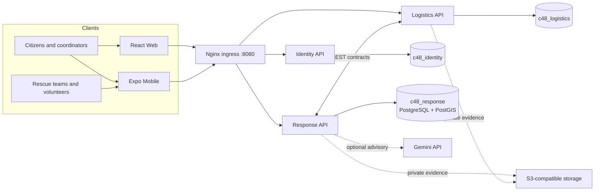

# Reliva

**Emergency Response and Disaster Relief Management System**<br>
**Vietnamese:** Hệ thống quản lý ứng phó khẩn cấp và cứu trợ thiên tai

Reliva is an academic capstone project for coordinating emergency reports, rescue missions, volunteer teams, and in-kind relief. Its Vietnamese Web and Mobile applications serve affected residents, rescue teams, coordinators, operations staff, and administrators.

> **Prototype only.** Reliva and its risk-assessment rules have not been validated for real emergency dispatch. Coordinators retain authority over verification, official priority, and team assignment. Use synthetic data for demonstrations.

## Project status

The latest T20 note (25 October 2026) records backend and Web builds plus OpenAPI and Compose-environment checks on Node 26.11.1, outside the declared Node 24 engine range. T20 tests, migrations, and seed execution were not run. The same note records two existing Mobile TypeScript errors in `LocationPickerModal.tsx` and `ScreenContainer.tsx`. See the [backend guide](docs/backend/README.md) for implementation status and remaining acceptance evidence.

**Contents:** [Capabilities](#what-the-system-supports) · [Architecture](#architecture) · [Technology](#technology) · [Local setup](#get-started-locally) · [Postman](#try-the-apis-in-postman) · [Development](#development-commands) · [Project documents](#project-documents)

## What the system supports

| Role | Main workflows |
|---|---|
| Citizen / reporter | Submit and update an SOS or assistance report, share a location, and follow progress. |
| Volunteer / rescue team | Maintain team availability and location, receive missions, report progress, and record outcomes. |
| Coordinator | Review and verify reports, consider risk factors, compare eligible teams, assign missions, and monitor operations. |
| Operations staff | Manage in-kind donation drives, warehouses, stock, vehicles, relief points, and distributions. |
| Administrator | Manage accounts, organizations, memberships, permissions, and operational records. |

The current implementation includes:

- Email OTP registration and Google ID-token sign-in/linking when configured.
- GPS-based SOS intake with incident details, household counts, danger reports, and rescue or supply needs.
- Reporter updates, verification workflows, scoped coordinator queues, request history, and tracking.
- Deterministic server-side risk factors and team suggestions based on eligibility, location freshness, distance, and recent workload. A coordinator makes the assignment.
- Mission progress and team history for operational review.
- In-kind donation declarations, independent intake review, stock accounting, fulfillment, and distribution records. Cash collection and payment processing are out of scope.
- Optional Gemini narrative extraction into structured JSON for human review, with a local limit of 500 calls per `America/Los_Angeles` calendar day. This is an application guard, not Google's project quota. AI output does not set official priority or dispatch a team.

## Architecture

Three NestJS services own separate PostgreSQL databases and communicate through versioned REST APIs. Nginx serves the Web application and routes public API requests through the same local origin.



In the default Compose setup, Web is served at `/`; public APIs use `/api/v1/identity`, `/api/v1/response`, and `/api/v1/logistics`. PostgreSQL hosts the three service-owned databases with separate credentials. Service-to-service routes under `/internal/` are not exposed through the public Nginx ingress.

## Technology

| Area | Technology |
|---|---|
| Backend APIs | NestJS, TypeScript, TypeORM, REST/JSON |
| Identity | Email OTP, Google ID-token verification, role- and region-scoped access |
| Database | PostgreSQL with PostGIS |
| Web | React, TypeScript, Vite, Nginx |
| Mobile | React Native, Expo, TypeScript |
| Local deployment | Docker Compose and Nginx |
| File evidence | Private S3-compatible interface; the capstone plan selects single-node MinIO AIStor Free, subject to current terms and limits |
| AI assistance | Optional server-side Gemini integration with schema-constrained output and human review |

## Repository layout

```text
backend/
  apps/identity/       Accounts, authentication, organizations, and permissions
  apps/response/       SOS reports, verification, teams, missions, and AI advisories
  apps/logistics/      Donations, inventory, fulfillment, and distribution
  infra/compose.yaml   The only Docker Compose definition
  postman/             Manual API collection and local-only environment
contracts/openapi/     Identity, Response, and Logistics API contracts
frontend/web/           Vietnamese React Web application
mobile/                 Vietnamese React Native / Expo application
docs/
  backend/              Setup, schemas, API guides, and acceptance evidence
  diagrams/             Architecture diagrams
```

## Get started locally

### Requirements

- Docker Engine and the Docker Compose plugin.
- Node.js `>=24.15.0 <25` and npm `>=10 <13` for host-side development and checks.
- Provider credentials only for the flows you plan to exercise.

### Configure the backend

For a fresh local setup, create the environment file without replacing an existing one, then generate signing keys and service secrets:

```bash
cp -n backend/.env.example backend/.env
node backend/scripts/dev/gen-keys.mjs
```

Set `EMAIL_OTP_PEPPER` to a separate random value and choose a local `SEED_PASSWORD`. Review the remaining values in `.env` and follow the [backend setup guide](docs/backend/00-setup.md). Keep `.env` private; never commit it or paste its contents into issues or chat.

If `backend/.env` already contains generated secrets, keep it and skip these two setup commands; the key generator intentionally refuses to rotate existing secrets.

### Start the core stack

From `backend/`:

```bash
docker compose up --build -d
```

Compose builds the Web and API images, initializes PostgreSQL, runs the declared migrations, and starts Nginx. Open **<http://127.0.0.1:8080>**. The default public host and service/database ports bind to loopback.

Demo data is optional and synthetic. Set `SEED_PASSWORD`, then run the declared seed job from `backend/`:

```bash
docker compose --profile seed up seed
```

Seeding does not reset existing data. Do not run `docker compose down -v`: it removes both PostgreSQL and object-storage volumes. If a full demo reset is intentional, use only the documented `bash scripts/db/reset-demo --reset` or `bash scripts/db/test-db --reset` command from `backend/`; those paths remove only `c48_pgdata` and preserve `c48_minio-data` and its objects.

The optional `storage` profile requires separate provider and license review. The project plan selects MinIO AIStor Free for single-node lab use; the Compose storage image, private access, and restore path must be checked against that decision before treating storage as accepted or using real evidence. See [technology plan §6.3](docs/c48-technology-and-delivery-plan.md#63-gps-and-evidence-files) and the [backend evidence guide](docs/backend/README.md).

### Try the APIs in Postman

Import [C48-backend-demo.postman_collection.json](backend/postman/C48-backend-demo.postman_collection.json). Requests default to the public Nginx ingress at `http://127.0.0.1:8080`. Select the local `C48 Local Demo` environment if you have it. That environment file is ignored by Git; on a fresh checkout, create it in Postman and set `seedPassword` to the same value as `SEED_PASSWORD` in `backend/.env`.

Start with a login request in the relevant actor folder, then send requests one at a time. The collection saves returned tokens, IDs, and versions where applicable. Use synthetic demo data: write requests persist in the primary databases.

- For a new citizen account, set `citizenEmail` to an unused mailbox you can access. SMTP must be configured to receive its OTP; enter the six-digit code in `emailOtpCode`. Send only one of the two registration requests for that email.
- Google sign-in/linking needs `GOOGLE_CLIENT_IDS` and a valid ID token in `googleIdToken`.
- AI review needs a coordinator session and an advisory on the request. Gemini is optional; AI output remains a suggestion.
- Evidence requests are skipped unless the collection variable `aiStorAvailable` is set to `true` after confirming storage is available.

## Configuration

Committed environment files are templates:

- [`backend/.env.example`](backend/.env.example) — backend, Compose, SMTP, Google allow-list, Gemini, and storage settings.
- [`frontend/web/.env.example`](frontend/web/.env.example) — public Web settings for direct Vite development.
- [`mobile/.env.example`](mobile/.env.example) — public Google client IDs for Expo platforms.

For Compose Web builds, `VITE_GOOGLE_CLIENT_ID` and the optional `VITE_GOOGLE_MAPS_API_KEY` are public build-time values read from `backend/.env`. Google client IDs are public identifiers. SMTP passwords, `GEMINI_API_KEY`, JWT private keys, and secret-hash peppers belong only in server-side configuration. Set `GOOGLE_CLIENT_IDS` to the permitted Web, Android, and iOS client IDs. `GEMINI_MODEL` defaults to `gemini-3.1-flash-lite`; the local 500-call limit is an application guard, not Google's project quota.

## Local endpoints

| Service | Address | Notes |
|---|---|---|
| Web and public API ingress | `http://127.0.0.1:8080` | Main browser and Postman origin; configurable with `PUBLIC_PORT` |
| Identity API | `http://127.0.0.1:3001` | Host-side development and checks |
| Response API | `http://127.0.0.1:3002` | Host-side development and checks |
| Logistics API | `http://127.0.0.1:3003` | Host-side development and checks |
| PostgreSQL | `127.0.0.1:55432` | Local development only; configurable with `POSTGRES_HOST_PORT` |

The API and database ports bind to loopback. Use Nginx for normal client and Postman requests.

## Development commands

Backend commands run from `backend/`:

```bash
npm ci
npm run build
npm test
npm run contracts:check
npm run check:compose-env
```

Web commands run from `frontend/web/`:

```bash
npm ci
npm run build
```

Mobile commands run from `mobile/`:

```bash
npm ci
npm start
npm run lint
```

There is one Compose file and no separate test database or helper container. Database and HTTP integration checks use the main APIs and primary `c48_identity`, `c48_response`, and `c48_logistics` databases. The documented database suite requires an explicit reset flag and resets primary PostgreSQL data; read [backend setup §8.5](docs/backend/00-setup.md) before running it.

## Security and operating limits

- All Web and Mobile user-facing text and backend human-readable responses are Vietnamese. Clients should branch on stable error codes, not message text.
- Use synthetic names, contact details, coordinates, and evidence for development and demonstrations.
- Keep evidence buckets private and authorize every upload/download against its owning request, mission, or distribution.
- Treat submitted descriptions as untrusted input. Minimize data sent to external AI providers; AI output is advisory and requires human review.
- Compose is a single-host development/demo deployment. It does not provide high availability, a production SLA, or validated emergency-response accuracy.
- Verify the selected storage artifact, license terms, private access, and restore process before using real evidence.

## Project documents

- [Project context and assigned scope](docs/c48-project-context.md)
- [Technology and delivery plan](docs/c48-technology-and-delivery-plan.md)
- [Backend setup, implementation status, and remaining evidence](docs/backend/README.md)
- [Postman collection](backend/postman/C48-backend-demo.postman_collection.json)
- [Identity API contract](contracts/openapi/identity.json) · [Response API contract](contracts/openapi/response.json) · [Logistics API contract](contracts/openapi/logistics.json)
- [Implemented system diagrams](docs/diagrams/c48-implemented-system.md)
- [T19 baseline contract traceability](docs/backend/T19-traceability.md)

## License

No repository-wide license is currently declared. Obtain permission from the project owners before reuse or redistribution.
