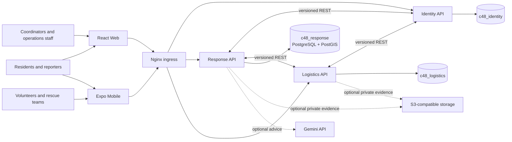

# Reliva (C48)

**Emergency Response and Disaster Relief Management System**

**Vietnamese:** Hệ thống quản lý ứng phó khẩn cấp và cứu trợ thiên tai

Reliva is a Web and Mobile project for coordinating emergency reports, rescue missions, volunteers, and in-kind relief. It connects affected residents with rescue teams, coordinators, operations staff, and administrators through a shared workflow and auditable records.

## Project information

- **Project code:** C48
- **Academic program:** Graduation capstone, class D22CQCNPM01-N
- **Advisor:** ThS. Trương Thị Mỹ Ngọc
- **Student team:** Nguyễn Lưu Tấn Sang (N22DCCN068), Vũ Ngọc Sơn (N22DCCN071), and Đỗ Xuân Trí (N22DCCN088)
- **Product language:** Vietnamese for Web, Mobile, and human-readable application messages

## Problem and goals

During floods, storms, landslides, and other emergencies, information about people who need help, available teams, and relief supplies can arrive through disconnected channels. Responders need to know whether a report was received, who is reviewing it, which team accepted a mission, what supplies were received, and what was delivered.

Reliva brings those records into one coordination system. Its goals are to:

- Receive SOS and assistance reports with incident details, location, contact information, and optional evidence.
- Help authorized coordinators verify reports, review possible duplicates, set priority, assign teams, and track outcomes.
- Help rescue teams receive missions, report progress, and record results.
- Coordinate relief campaigns, donation drives, warehouses, vehicles, relief points, stock, and distribution.
- Provide scoped maps, operational dashboards, reports, and history for accountability.

The project’s research compares the coordination needs addressed by platforms and approaches such as Ushahidi, Sahana Eden, Vietnamese volunteer response sites, Zalo SOS, and shared phone/spreadsheet workflows. Reliva focuses on linking intake, verification, team missions, in-kind donation review, stock, and distribution records in one traceable flow. The full background and comparison are in the [project report](report/main.tex).

## People and workflows

| Role | Main activities |
|---|---|
| Resident or reporter | Submit an SOS for themselves or report a household, share the affected location, follow progress, and add information when allowed. |
| Volunteer or rescue team | Maintain team skills and availability, view assigned missions, accept or decline offers, update progress, and report outcomes. |
| Coordinator | Review reports, verify information, handle duplicates, set official priority, select and assign eligible teams, and monitor work on scoped maps and queues. |
| Campaign or operations manager | Manage campaigns, donation drives, warehouses, vehicles, relief points, supply needs, commitments, and distribution. |
| Intake staff and independent reviewer | Record donated goods, count and classify items, preserve discrepancies, and approve or reject a count independently. |
| Distribution staff and receiving party | Prepare and approve distributions, dispatch supplies, record handoffs, and reconcile delivery, return, or loss. |
| System administrator | Manage accounts, organizations, membership, access grants, and administrative history. |

Key workflows include:

1. **SOS intake:** A resident submits a self-report (`SELF`) as a guest or signed-in user. Reporting for a household at another location (`PROXY`) requires sign-in. Reporter details stay distinct from the affected person’s details.
2. **Review and response:** A coordinator verifies the report, records the decision and reason, reviews duplicate candidates, sets priority, and offers a mission to an eligible team. Team acceptance and progress update the request timeline.
3. **In-kind relief:** A donor declares goods handed over. Intake staff count the goods; a separate reviewer checks that count before accepted quantities enter stock. Needs, commitments, stock movements, distributions, and handoffs remain separately traceable.
4. **Operational monitoring:** Authorized users view queues, team locations, campaigns, inventory, fulfillment, and reports within their organization, region, or assigned resource scope.

## Requirements and use cases

The report preserves requirement and use-case identifiers for traceability.

| ID | Requirement area |
|---|---|
| UR-01–02 | Submit SOS or household assistance reports, track progress, and provide permitted updates. |
| UR-03–04 | Verify and prioritize reports; review teams and manage assigned missions. |
| UR-05–07 | Manage campaigns and relief operations, accounts and permissions, dashboards, and service information. |
| UR-08–10 | Declare donations, independently count and review them, and distribute or reconcile goods. |

| Functional requirement group | Coverage |
|---|---|
| `FR-IAM-01..03` | Authentication, sessions, accounts, and scoped permissions. |
| `FR-REQ-01..11` | SOS intake, tracking, updates, review, duplicate handling, priority, and history. |
| `FR-MSN-01..06`, `FR-TEAM-01` | Team profiles, skills, availability, mission assignment, and progress. |
| `FR-MAP-01` | Scoped operational maps and heatmaps without public personal details or automatic dispatch. |
| `FR-CAM-01`, `FR-LOG-01..07` | Campaigns, supply needs, commitments, inventory, and partial fulfillment. |
| `FR-DON-01..05` | Donation drives, declarations, independent review, receipts, and disputes. |
| `FR-REC-01`, `FR-RPT-01`, `FR-AUD-01` | Reconciliation, reports, and audit history. |
| `FR-FILE-01`, `FR-NOT-01..02` | Private evidence files and in-app notifications; device push is an extension. |
| `FR-OFF-01`, `FR-AI-01..07`, `FR-EVT-01` | Optional offline, AI, and event extensions. Core workflows do not depend on them. |

The report also groups non-functional requirements around security (`NFR-SEC-01..04`), privacy (`NFR-PRV-01`), reliability (`NFR-REL-01`), performance targets (`NFR-PERF-01..02`), usability (`NFR-UX-01`), Vietnamese localization (`NFR-L10N-01`), compatibility (`NFR-COMP-01`), and testing and operations (`NFR-TEST-01`, `NFR-OPS-01`). Performance values are project targets: 10,000 requests, 20 concurrent virtual users, read API p95 at or below 2 seconds, SOS submission at or below 3 seconds excluding uploads, and HTTP errors below 1% during a stable measurement interval.

Principal use cases include `UC-01` SOS intake, `UC-02` report verification, `UC-03` mission assignment, `UC-04` partial fulfillment, `UC-05` dashboards and reports, `UC-06` account administration, `UC-07` optional AI advice, `UC-08` campaign management, `UC-09` relief assets, `UC-10..13` donations and distribution, `UC-15` proxy reporting, `UC-16` maps and queues, and `UC-17/18` team profiles and missions.

The project deliverables include the Web/Mobile system, requirements and design documentation (SRS/SDD), use cases, test cases, installation and user guides, and demonstration materials.

## Scope boundaries and operating principles

- Relief collection covers physical goods. Cash collection and payment processing are outside the project scope.
- Verification, official priority, and dispatch are human decisions. AI can provide structured summaries or advice for review; it cannot automatically prioritize or assign rescue work.
- SOS location is captured as a point with its source, accuracy when available, capture time, and server receive time. Continuous background tracking is outside the core workflow.
- Guests can submit a self-report. A remote household report requires a signed-in reporter; the affected household does not need an account.
- External agencies are coordination partners, not automatically internal system users.
- Use synthetic names, contact details, locations, and files for development and demonstrations. The system is a coordination tool and does not replace the authority of emergency services or response commanders.

## Architecture and data ownership



Each NestJS service owns its database, credentials, migrations, and business records. Services exchange identifiers and data through versioned REST APIs; they do not share database tables or create cross-service foreign keys.

| Component | Data and responsibility |
|---|---|
| Identity | Accounts, authentication, organizations, regions, memberships, scoped grants, and session records. |
| Response | SOS requests, affected-person and location records, verification history, teams, missions, campaigns, and operational notifications. |
| Logistics | Supply catalog, warehouses, drives, donor declarations, counts and reviews, stock ledger, needs, commitments, distributions, and handoffs. |
| Web and Mobile | Vietnamese role-based interfaces for public intake and operational workflows. Authorization is enforced by the APIs, not by hiding interface controls. |
| Object storage | Private evidence files. PostgreSQL stores ownership and file metadata; the owning API authorizes access. |

## Technology choices

| Area | Technology |
|---|---|
| Backend | NestJS, TypeScript, TypeORM, REST/JSON |
| Databases | PostgreSQL; PostGIS for location data in Response |
| Web | React, TypeScript, Vite |
| Mobile | React Native, Expo, TypeScript |
| Ingress and local stack | Nginx and Docker Compose |
| Evidence storage | MinIO AIStor Free, selected for a single-node academic lab, subject to its license and tier limits |
| Optional AI provider | Gemini, with schema-constrained output and coordinator review |

NestJS/TypeScript was selected after comparison with Spring Boot, Django REST Framework, FastAPI, and Flask. The shared TypeScript stack supports the backend and clients; PostgreSQL/PostGIS provides relational transactions and spatial queries. These are design choices for the project, not requirements from the original brief.

## Data protection and integrity

- Locations use WGS84/SRID 4326; GeoJSON coordinates are ordered longitude then latitude. Keep location source, capture time, accuracy, and server receive time distinct.
- Scope exact locations, phone numbers, files, queues, exports, and notifications to authorized roles and regions. Public maps and reports do not expose personal identifiers.
- Record important decisions with the actor, time, reason, and before/after state. Retryable commands use idempotency keys.
- Treat stock movements as the ledger. A donor declaration does not add stock; accepted goods enter inventory only after an independent review.
- Keep object-storage buckets private and authorize each download against its owning request, mission, or distribution.
- Use Vietnamese for all user-facing Web/Mobile copy and backend human-readable messages. API field names, error codes, enum values, and identifiers remain stable machine-readable contracts.

## Repository map

```text
backend/
  apps/identity/       Accounts, authentication, organizations, and permissions
  apps/response/       SOS reports, verification, teams, missions, and AI advice
  apps/logistics/      Donations, inventory, fulfillment, and distribution
  infra/compose.yaml   The single Compose definition
  scripts/db/          Migrations, synthetic seeding, backup, and recovery tools
  postman/             API collection for manual demonstrations
contracts/openapi/     Identity, Response, and Logistics API contracts
frontend/web/           Vietnamese React Web application
mobile/                 Vietnamese React Native / Expo application
docs/
  backend/              Setup, schemas, API guides, permissions, and seed data
  diagrams/             Architecture and data-model diagrams
report/main.tex         Full Vietnamese project report source
```

## Run the local demonstration stack

### Requirements

- Docker Engine and the Docker Compose plugin.
- Node.js `>=24.15.0 <25` and npm `>=10 <13` for host development and checks.
- Provider credentials only for optional flows you want to exercise.

### Configure and start

From the repository root:

```bash
cp -n backend/.env.example backend/.env
node backend/scripts/dev/gen-keys.mjs
```

Set a local `SEED_PASSWORD` and `EMAIL_OTP_PEPPER` in `backend/.env`, then review the [backend setup guide](docs/backend/00-setup.md). Keep `.env` private.

Start the core stack from `backend/`:

```bash
docker compose up --build -d
```

The Web application and public API ingress use <http://127.0.0.1:8080>. API paths are `/api/v1/identity`, `/api/v1/response`, and `/api/v1/logistics`.

Load synthetic demo data from `backend/`:

```bash
docker compose --profile seed up seed
```

On empty databases, the seed job loads the full fixtures. On populated databases, it adds deterministic demo users, regions, campaigns, teams, reports, and relief records with insert-only statements. It does not reset existing data. The optional `storage` profile requires a separately obtained AIStor Free license; see [technology plan §6.3](docs/c48-technology-and-delivery-plan.md#63-gps-and-evidence-files).

Do not use `docker compose down -v`. For an intentional demo reset, use only `bash scripts/db/reset-demo --reset` or `bash scripts/db/test-db --reset` from `backend/`; these reset only `c48_pgdata` and preserve `c48_minio-data` and its objects.

### Development commands

Backend commands run from `backend/`:

```bash
npm ci
npm run build
npm test
npm run contracts:check
npm run check:compose-env
```

Web commands run from `frontend/web/`:

```bash
npm ci
npm run build
```

Mobile commands run from `mobile/`:

```bash
npm ci
npm start
npm run lint
```

Database and API integration checks use the primary C48 databases and APIs. See the [backend setup guide](docs/backend/00-setup.md) before running database checks.

## Project documents and API contracts

- [Full project report (LaTeX source)](report/main.tex)
- [Assigned project scope and context](docs/c48-project-context.md)
- [Technology and delivery plan](docs/c48-technology-and-delivery-plan.md)
- [Backend setup and database rules](docs/backend/00-setup.md)
- [Backend architecture and guide](docs/backend/README.md)
- [Identity API contract](contracts/openapi/identity.json) · [Response API contract](contracts/openapi/response.json) · [Logistics API contract](contracts/openapi/logistics.json)
- [System diagrams](docs/diagrams/c48-implemented-system.md)
- [Postman demonstration collection](backend/postman/C48-backend-demo.postman_collection.json)
