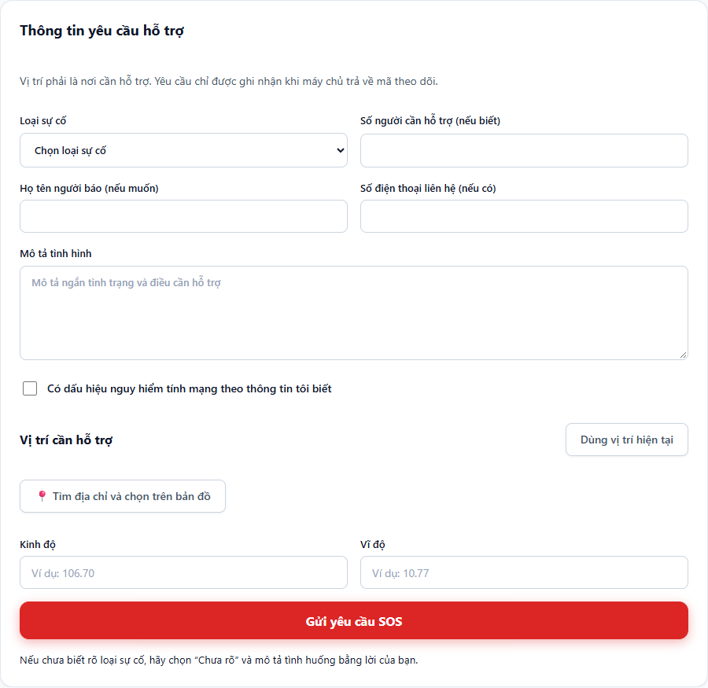
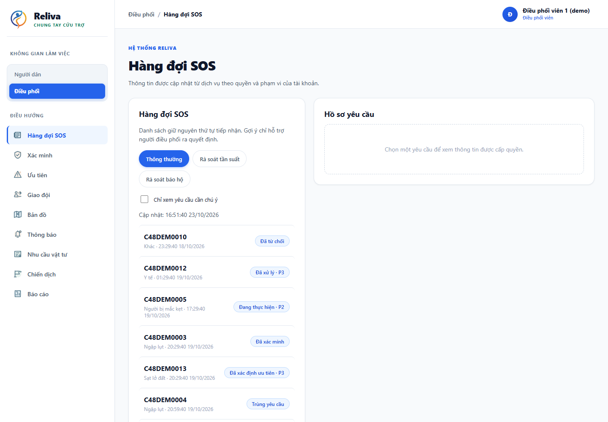
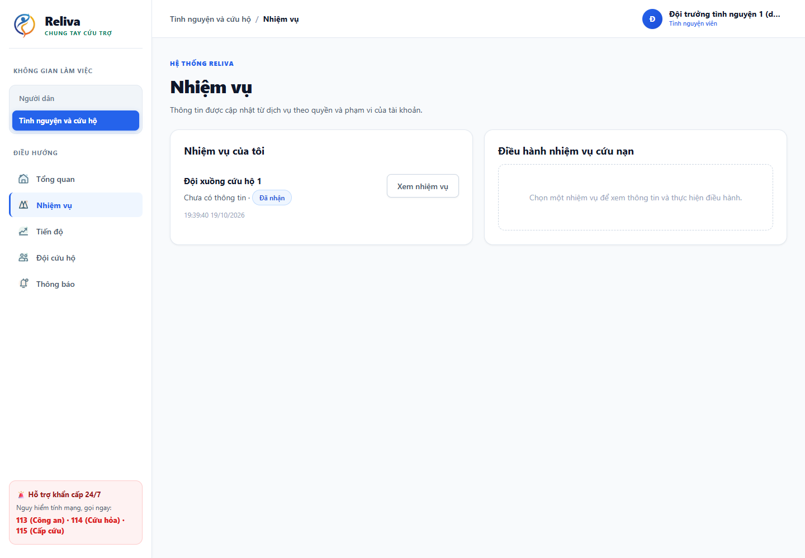
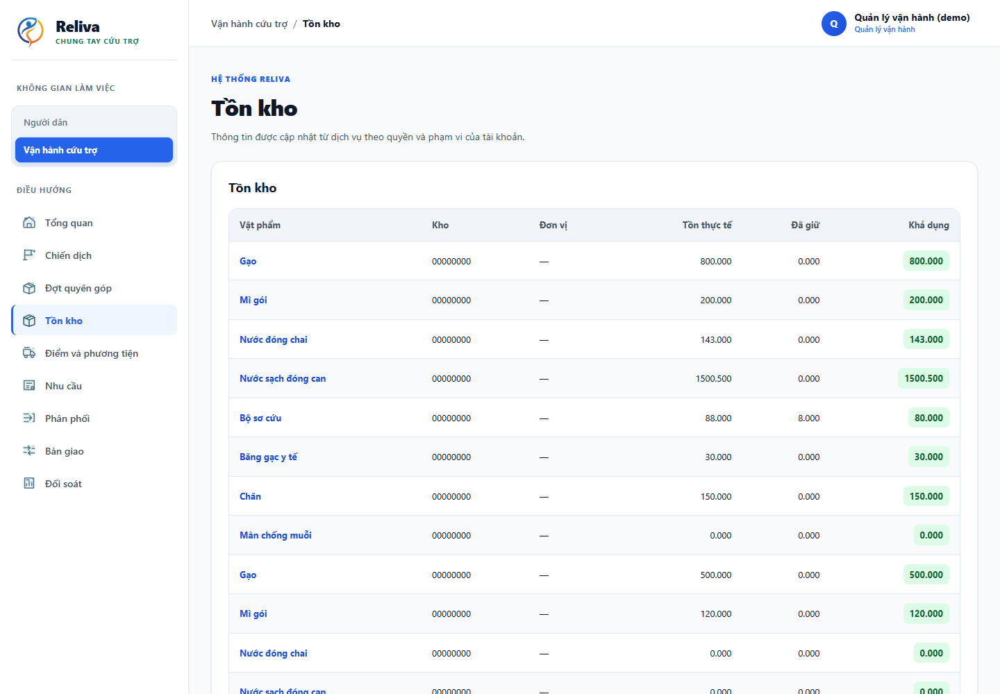
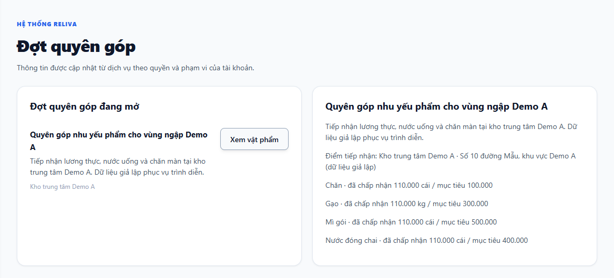
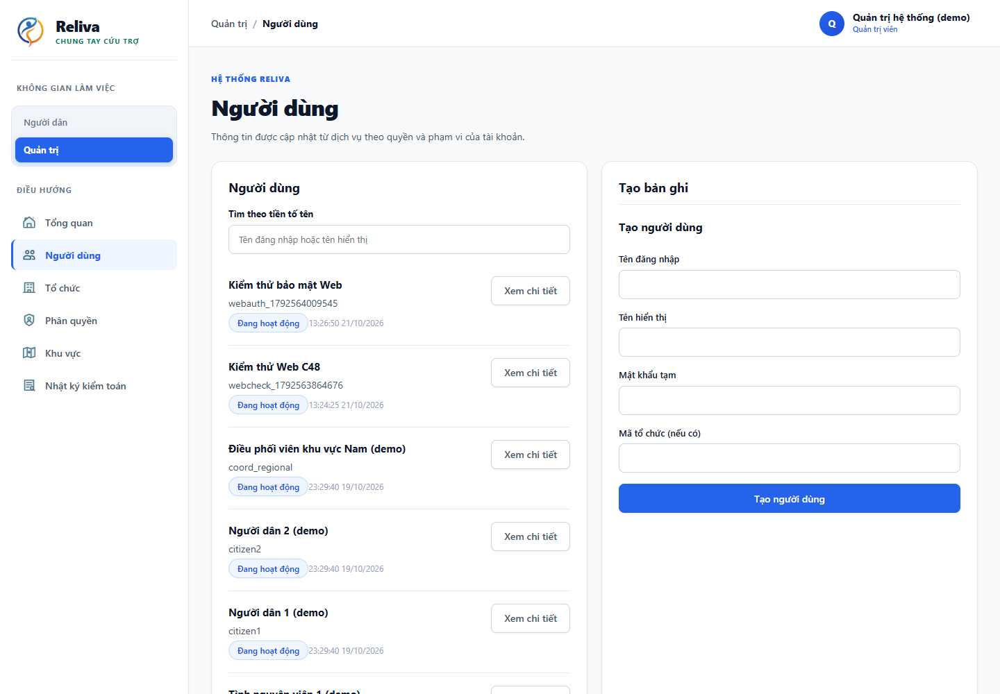
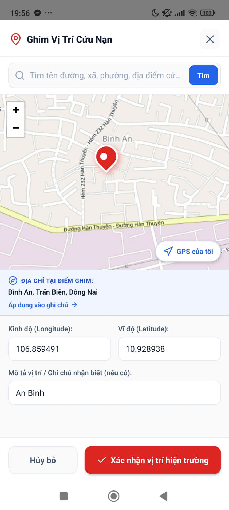
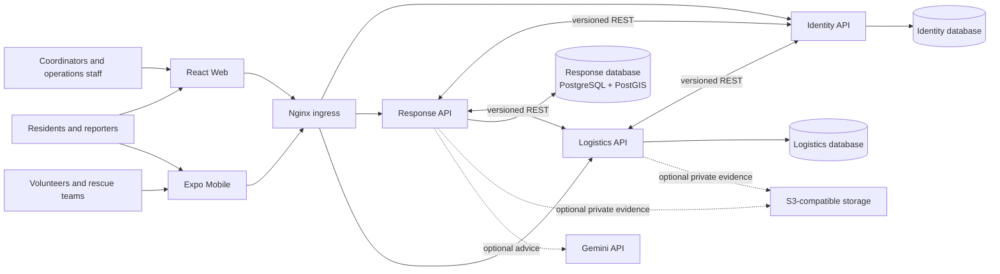

<div align="center">


# Reliva

### Emergency Response and Disaster Relief Management System

*Hệ thống quản lý ứng phó khẩn cấp và cứu trợ thiên tai*

**From an SOS call to a verified rescue mission and an auditable relief delivery, in one coordinated workflow.**


[Overview](#-overview) · [Screenshots](#-screenshots) · [Features](#-key-features) · [Architecture](#-architecture) · [Tech stack](#-tech-stack) · [Quick start](#-quick-start) · [Docs](#-documentation)

</div>

---

## Overview

During floods, storms, and landslides, information about people who need help, available rescue teams, and relief supplies arrives through disconnected channels: phone calls, social posts, chat groups, and spreadsheets. Responders cannot tell whether a report was received, who is reviewing it, which team accepted it, or what was actually delivered.

**Reliva** connects affected residents, rescue teams, coordinators, operations managers, and administrators through one shared, traceable system on **Web and Mobile**.

| | |
|---|---|
| **Report** | Residents send a GPS-based SOS, as a guest or signed in, for themselves or on behalf of a household. |
| **Verify** | Coordinators review reports, resolve duplicates, and set the official priority. A human always decides. |
| **Respond** | Eligible rescue teams receive missions, accept or decline, report progress, and record the outcome. |
| **Relieve** | Campaigns, donation drives, warehouses, stock, and distribution stay linked end to end. |
| **Account** | Every important decision keeps its actor, time, reason, and before/after state. |

> The core demo path is **SOS → human verification and priority → team assignment and progress → resolution**. Donations and logistics are supporting capabilities. AI is optional and only advises coordinators.

## Screenshots

### Web

<table>
  <tr>
    <td width="50%"><br /><sub><b>Citizen SOS intake</b></sub></td>
    <td width="50%"><br /><sub><b>Coordinator queue and map</b></sub></td>
  </tr>
  <tr>
    <td width="50%"><br /><sub><b>Volunteer and rescue missions</b></sub></td>
    <td width="50%"><br /><sub><b>Warehouse and stock operations</b></sub></td>
  </tr>
  <tr>
    <td width="50%"><br /><sub><b>Donation drives</b></sub></td>
    <td width="50%"><br /><sub><b>Account and access administration</b></sub></td>
  </tr>
</table>

### Mobile

<table>
  <tr>
    <td align="center"><br /><sub><b>Home</b></sub></td>
    <td align="center"><br /><sub><b>Map</b></sub></td>
    <td align="center"><br /><sub><b>Mission list</b></sub></td>
    <td align="center"><br /><sub><b>Mission detail</b></sub></td>
  </tr>
  <tr>
    <td align="center"><br /><sub><b>Evidence upload</b></sub></td>
    <td align="center"><br /><sub><b>Team leader dashboard</b></sub></td>
    <td align="center"><br /><sub><b>Relief donation</b></sub></td>
    <td align="center"><br /><sub><b>Handoff declaration</b></sub></td>
  </tr>
</table>

All user-facing copy is in **Vietnamese**, in line with the project's language policy.

## Key features

### Emergency response
- **GPS-based SOS** for a guest or signed-in resident, with `SELF` and `PROXY` (report for another household) modes.
- Reporter and affected-person details are stored separately.
- Location keeps its source, accuracy, capture time, and server receive time as distinct values.
- **Verification workflow**: decision and reason, duplicate-candidate review, official priority.
- **Mission assignment** to eligible teams. Teams accept or decline, post progress, and report results into the request timeline.
- **Scoped operational maps and queues** limited by organization, region, or assigned resource, with no public personal details.

### Relief and logistics
- Campaigns, supply needs, commitments, warehouses, vehicles, and relief points.
- **Independent counting and review**: a donor declaration never adds stock. Only goods counted and approved by a separate reviewer enter inventory.
- **Stock ledger**: stock movements are the single source of truth.
- Distribution, handoff, and delivery/return/loss reconciliation.

### Platform
- **Role-based and scope-based access** (resident, volunteer/team, coordinator, operations manager, intake and reviewer staff, admin). Authorization is enforced in the APIs, not by hiding buttons.
- **Audit trail** with actor, time, reason, and before/after state. Retryable commands use idempotency keys.
- **Private evidence storage** (photos and files) with per-owner authorization on every download.
- **Optional AI advice** (Gemini, schema-constrained output, Vietnamese explanations) that is always human-reviewed and never prioritizes or dispatches on its own.

## Architecture



Reliva uses **three domain services**. Each NestJS service owns its database, credentials, migrations, and business records. Services exchange identifiers through versioned REST APIs, with **no shared tables and no cross-service foreign keys**.

| Service | Owns |
|---|---|
| **Identity** | Accounts, authentication, organizations, regions, memberships, scoped grants, sessions. |
| **Response** | SOS requests, affected-person and location records, verification history, teams, missions, campaigns, notifications. |
| **Logistics** | Supply catalog, warehouses, drives, donor declarations, counts and reviews, stock ledger, needs, commitments, distributions, handoffs. |

More diagrams: [system overview](docs/diagrams/c48-system-overview.svg) · [container architecture](docs/diagrams/c48-container-architecture.svg) · [use cases](docs/diagrams/c48-overall-use-cases.svg) · [physical ERD (65 tables)](docs/diagrams/erd/c48-erd-physical-overall.svg)

## Tech stack

| Layer | Technology |
|---|---|
| **Backend** | NestJS 12, TypeScript, TypeORM, REST/JSON, class-validator |
| **Database** | PostgreSQL 17 with PostGIS 3.5, one database per service |
| **Web** | React 19, TypeScript, Vite, Leaflet, MapLibre GL |
| **Mobile** | React Native, Expo (Expo Router), TanStack Query, Zustand, react-native-maps |
| **API contracts** | OpenAPI for each service, with TypeScript types generated for the Web client |
| **Gateway and infra** | Nginx ingress, Docker Compose (single stack) |
| **Object storage** | MinIO Community, built from the upstream source tag, single-node lab setup |
| **Optional AI** | Gemini with schema-constrained output and coordinator review |

**Why NestJS?** It was chosen after comparison with Spring Boot, Django REST Framework, FastAPI, and Flask. One TypeScript stack across backend, Web, and Mobile keeps contracts consistent, and PostgreSQL/PostGIS provides relational transactions together with spatial queries. See the [technology and delivery plan](docs/c48-technology-and-delivery-plan.md).

## Data protection and integrity

- Locations use WGS84 (SRID 4326), with GeoJSON ordered longitude then latitude.
- Exact locations, phone numbers, files, queues, exports, and notifications are scoped to authorized roles and regions.
- Buckets are private. Every download is authorized against its owning request, mission, or distribution.
- Machine-readable contracts (paths, field names, error codes, enums) stay stable and English. Clients branch on codes, never on Vietnamese message text.
- Use synthetic names, contacts, locations, and files for development and demos.

Scope boundaries: relief covers physical goods only (no cash or payments), and Reliva is a coordination tool that does not replace emergency services or incident commanders.

## Quick start

**Requirements:** Docker Engine with the Compose plugin, Node.js `>=24.15.0 <25`, npm `>=10 <13`.

```bash
# 1. Configure (from the repository root)
cp -n backend/.env.example backend/.env
node backend/scripts/dev/gen-keys.mjs
# Set SEED_PASSWORD and EMAIL_OTP_PEPPER in backend/.env, and keep .env private.

# 2. Start the stack (from backend/)
cd backend
docker compose up --build -d

# 3. Load synthetic demo data
docker compose --profile seed up seed
```

Open **<http://127.0.0.1:8080>** for the Web app and API ingress. API prefixes are `/api/v1/identity`, `/api/v1/response`, and `/api/v1/logistics`.

> Never run `docker compose down -v`. For an intentional demo reset use only `bash scripts/db/reset-demo --reset` or `bash scripts/db/test-db --reset`. These remove only PostgreSQL data and keep MinIO objects. The optional MinIO store runs under the `storage` profile.

<details>
<summary><b>Development commands</b></summary>

```bash
# Backend (from backend/)
npm ci
npm run build
npm test
npm run contracts:check
npm run check:compose-env

# Web (from frontend/web/)
npm ci
npm run dev        # local dev server
npm run build      # typecheck and production build

# Mobile (from mobile/)
npm ci
npm start          # Expo
npm run lint
```

Integration and smoke checks run from the host against the main stack's APIs and primary databases. See the [backend setup guide](docs/backend/00-setup.md) first.

</details>

## Repository map

```text
backend/
  apps/identity/       Accounts, authentication, organizations, permissions
  apps/response/       SOS, verification, teams, missions, AI advice
  apps/logistics/      Donations, inventory, fulfillment, distribution
  infra/compose.yaml   The single Compose definition
  scripts/db/          Migrations, synthetic seed, backup and recovery
  postman/             API collection for demos
contracts/openapi/     Identity, Response, Logistics API contracts
frontend/web/          Vietnamese React Web application
mobile/                Vietnamese React Native / Expo application
docs/                  Plan, backend guides, diagrams, weekly reports
report/main.tex        Full Vietnamese project report (LaTeX)
```

## Requirements traceability

Identifiers are preserved from the report through the implementation.

| Area | IDs |
|---|---|
| User requirements | `UR-01..10` |
| Identity and access | `FR-IAM-01..03` |
| SOS requests | `FR-REQ-01..11` |
| Teams and missions | `FR-TEAM-01`, `FR-MSN-01..06` |
| Maps | `FR-MAP-01` |
| Campaigns and logistics | `FR-CAM-01`, `FR-LOG-01..07` |
| Donations | `FR-DON-01..05` |
| Reconciliation, reports, audit | `FR-REC-01`, `FR-RPT-01`, `FR-AUD-01` |
| Files and notifications | `FR-FILE-01`, `FR-NOT-01..02` |
| Optional extensions | `FR-OFF-01`, `FR-AI-01..07`, `FR-EVT-01` |
| Use cases | `UC-01..18` |

Performance targets: 10,000 requests at 20 concurrent virtual users, read API p95 at or below 2 s, SOS submission at or below 3 s excluding uploads, and HTTP errors below 1%.

## Documentation

| Document | Link |
|---|---|
| Full project report (LaTeX) | [report/main.tex](report/main.tex) |
| Project scope and context | [docs/c48-project-context.md](docs/c48-project-context.md) |
| Technology and delivery plan | [docs/c48-technology-and-delivery-plan.md](docs/c48-technology-and-delivery-plan.md) |
| Backend setup and database rules | [docs/backend/00-setup.md](docs/backend/00-setup.md) |
| Backend architecture guide | [docs/backend/README.md](docs/backend/README.md) |
| API contracts | [Identity](contracts/openapi/identity.json) · [Response](contracts/openapi/response.json) · [Logistics](contracts/openapi/logistics.json) |
| System diagrams | [docs/diagrams/c48-implemented-system.md](docs/diagrams/c48-implemented-system.md) |
| Postman demo collection | [backend/postman](backend/postman/C48-backend-demo.postman_collection.json) |

---

<div align="center">

**Reliva** · capstone project (C48) · built to help responders see, decide, and act faster.

</div>
