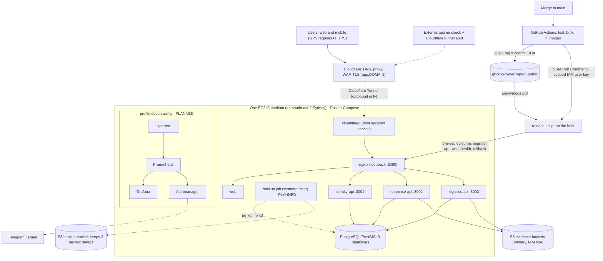

# Reliva Deployment and Operations Architecture (AWS single-host, k3s-ready)

| Attribute | Value |
|---|---|
| Project | Reliva (original project code C48) |
| Status | **Partly implemented 2026-11-22.** The single-host stack, S3 storage, Cloudflare Tunnel, GitHub Actions delivery and release rollback are live or implemented (see the [handoff](c48-deployment-handoff.md) for what was verified); backups, monitoring, log shipping and load tests are still proposals. Nothing is benchmarked. Region, credentials and some details differ from the first proposal: see section 15. |
| Scope | Where and how the existing Compose stack runs in production-like conditions: domain and edge, storage, reliability, backup, monitoring and logging, capacity, scaling path, cost, rollout. |
| Out of scope | Application features, schema and API contracts (see `backend/README.md`, `docs/backend/` and the technology plan). |
| Handoff | [Deployment handoff](c48-deployment-handoff.md): what was done, verified and left open on 2026-11-22. |
| Implementation | [Deployment runbook](c48-deployment-runbook.md): production `.env` template, `release` script, GitHub Actions pipeline, S3 configuration (status 2026-11-22: implemented and unit-tested, not yet run on the real host). |
| Related | [Technology and delivery plan](c48-technology-and-delivery-plan.md) §6.3, §14, §15; `backend/infra/compose.yaml`; `backend/scripts/db/`; `docs/diagrams/deployment/c48-deployment-architecture.pdf` (3 pages: deployment overview, reliability/backup/rollback, delivery pipeline; sources are the SVG files in the same folder). |

Labels follow the plan's convention: **Decision** (confirmed by the user), **Proposal** (recommended, not yet confirmed), **Needs confirmation** (open question or unverified fact). Prices and provider limits below were not re-verified unless a source is cited; confirm them before relying on them.

## 1. Goals, decisions and constraints

**Decisions (user, 2026-11-22):**

- One AWS EC2 instance (`t3.medium`) runs the whole stack with Docker Compose. No EKS.
- **k3s is a later extension**, not the first deployment (see §9).
- The domain is already registered at Cloudflare; Cloudflare provides DNS, proxy, TLS and the tunnel (see §3).
- **Object storage per environment:** **MinIO for local development and tests** (existing `storage` profile), **Amazon S3 as the primary store on AWS**. The same S3 client and code serve both; only configuration differs (endpoint, region, credentials, bucket names). The earlier MinIO-primary/S3-fallback design (circuit breaker, drain job, `storage_backend` column) is **dropped**.
- **Images up to 10 MiB are accepted and their resolution is reduced by the backend before they are stored in S3** (see §6.2).
- For the remaining open choices the user delegated the decision; §14 records the common enterprise-practice choice and the reason for each.
- Monitoring runs on the same host unless the user later chooses a hosted option.
- Keep cost low; the AWS credit (about USD 100) should last as long as possible.

**Conflict with project guidance (must be resolved before implementation):** `AGENTS.md` and plan §6.3/§12 select MinIO Community as the object store and forbid a second Compose file or test containers. The user asked to set that guidance aside for the AWS deployment. Record the decision in the plan, keep MinIO (`storage` profile) for local development and tests, and keep the single-Compose-file invariant. **Needs confirmation:** update `AGENTS.md`, plan §6.3 and `docs/backend/00-setup.md` accordingly.

**Invariants kept:**

- `backend/infra/compose.yaml` stays the only Compose file; new services use profiles inside it.
- Normal startup never removes volumes; reset only through the explicit `--reset` commands.
- Machine-readable contracts stay English and stable; user-facing messages stay Vietnamese. Logs and dashboards must not leak secrets or PII.

## 2. Target architecture

Key properties:

- **No inbound ports.** The security group opens nothing inbound; `cloudflared` makes outbound connections only, so the instance IP is not exposed. Administration uses AWS Systems Manager Session Manager, not SSH.
- **Existing nginx stays the single ingress** (rate limits, SOS never-drop throttling, security headers, plan §14). The tunnel forwards to nginx's loopback port (`PUBLIC_HOST`/`PUBLIC_PORT`). `cloudflared` runs as a host service, so Compose gains no container for it.
- PostgreSQL and all exporters listen on loopback or the internal Compose network only.
- Grafana and Alertmanager are not routed through the public nginx. Reach them through a Cloudflare Access protected hostname or an SSM port forward.
- S3 is reached over HTTPS by the backend; the instance never serves object bytes from its own disk.

## 3. Domain and Cloudflare (the existing domain)

The domain is registered at Cloudflare, so DNS, proxy, TLS and the tunnel are managed in one dashboard. No separate DNS provider, certificate authority or AWS Route 53/ACM/ALB is needed.

| Hostname | Points to | Purpose | Protection |
|---|---|---|---|
| `app.<domain>` | Tunnel, then nginx `:8080` | Web UI and `/api/v1/*` (same origin) | Public; nginx throttling, Cloudflare WAF |
| `grafana.<domain>` | Tunnel, then Grafana | Operator dashboards | **Cloudflare Access** (login required) |
| (none) | — | PostgreSQL, exporters, S3 | Never published |

How it works:

1. Create a tunnel (Zero Trust, Networks, Tunnels) and install `cloudflared` on the EC2 instance as a systemd service. Add public hostnames to the tunnel; Cloudflare creates the proxied DNS records (CNAME to `<tunnel-id>.cfargotunnel.com`) automatically.
2. Browser to Cloudflare uses HTTPS with a Cloudflare-managed certificate; Cloudflare to the instance travels inside the tunnel, so the origin needs no public certificate and the instance has no open port. HTTPS is mandatory because browser geolocation (GPS) requires a secure context.
3. **Same-origin API:** nginx already routes `/api/v1/identity|response|logistics/*`, so the browser and the mobile app call `https://app.<domain>/api/v1/...`. A separate `api.` hostname is not needed and CORS stays simple.
4. Configuration that must use the real domain (`backend/.env`, never committed): `WEB_ALLOWED_ORIGINS=https://app.<domain>`, `JWT_ISSUER`, `JWT_AUDIENCE`, and the mobile app's API base URL. `S3_PUBLIC_ENDPOINT` is no longer needed once files are served from S3 (see §6).
5. **Real client IP (must fix):** `proxy-common.conf` sets `X-Forwarded-For $remote_addr` and nginx has no real-IP handling. Behind the tunnel `$remote_addr` is `cloudflared`, so every user would share one IP and the per-IP SOS limits (`SOS_HARD_LIMIT_PER_IP`) would throttle everyone. Configure nginx to trust the `CF-Connecting-IP` header only from the tunnel source (`set_real_ip_from` plus `real_ip_header`), and re-test the SOS limits.
6. Email uses the existing Gmail SMTP (§10), so no mail DNS records are needed now. If a domain-based sender (for example SES) is adopted later, add its SPF/DKIM/DMARC records in the same zone, with DKIM CNAMEs **DNS only** (grey cloud), not proxied.
7. **Needs confirmation:** Cloudflare's request body limit on the Free plan (documented as 100 MB at the time of writing) is above the application's 55 MB limit (§6.2); proxy timeouts (about 100 s) must exceed the slowest upload.

## 4. Compute and sizing

| Item | Proposal | Notes |
|---|---|---|
| Region | **`ap-southeast-2` (Sydney) in use** (proposal was `ap-southeast-1`, Singapore) | The shared account's project is pinned to Sydney; other regions need *Activate advanced features*, which was not enabled (billing effect not verified). Latency from Vietnam is higher than Singapore. |
| Instance | `t3.medium` (2 vCPU, 4 GB), Ubuntu LTS | Move to `t3.large` only if k6 shows memory pressure (§8, §9). |
| Disk | gp3, 30–40 GB | Holds PostgreSQL data, logs and Docker images. File objects live in S3, not here. |
| Swap | 2 GB swap file | Safety margin on 4 GB. |
| Access | SSM Session Manager | No SSH port open. |

Estimated memory (not measured): PostgreSQL 0.5–0.8 GB, three APIs 0.45–0.9 GB, web and nginx 0.05–0.15 GB, OS/Docker/cloudflared 0.4–0.6 GB, so about 1.4–2.5 GB without monitoring and 2.0–3.7 GB with it. With MinIO removed on AWS, 0.2–0.5 GB is freed. Keep monitoring lean: **no Loki** and **no cAdvisor** by default. **Needs confirmation:** measure with `docker stats` during the k6 run.

## 5. Reliability: container failure, host failure, data safety

### 5.1 Compose hardening (Proposal; first two items applied in `compose.yaml`)

- `restart: unless-stopped` on every long-running service (postgres, three APIs, web, nginx). Migration/seed jobs keep `restart: "no"`. Before this change the long-running services had **no restart policy**, so a crashed container stayed down.
- Docker log rotation (`json-file`, `max-size: 10m`, `max-file: 5`) on every service so logs cannot fill the disk.
- Healthchecks already exist for the APIs, web, nginx and PostgreSQL. Keep `/health/ready` for orchestration and `/health/live` for the external check.
- **Memory limits (`mem_limit`) per container:** set them from measured `docker stats` values after the k6 run, not guessed now, so one service cannot starve the host.
- Alert on container restart loops (§7.3).

### 5.2 What each failure does

| Failure | Mechanism | Data outcome |
|---|---|---|
| A container crashes | Restart policy brings it back; nginx healthcheck gates traffic | Committed data is in PostgreSQL; nothing lost |
| A request is interrupted | Idempotency keys (already implemented) let clients retry | No duplicate writes |
| An upload is interrupted | PENDING/READY attachment states plus reconciliation (plan §6.3) | No metadata row points at a missing object |
| A dependent service is down (for example logistics) | Cross-service circuit breaker returns a stable 503 code | Only the dependent operations pause. **Verify with a drill** that the SOS path stays available |
| PostgreSQL data is lost or corrupted | Restore from the latest verified dump in the backup bucket (§6.3) | Loss is at most one backup interval (RPO) |
| Evidence object deleted by mistake | S3 versioning on the evidence buckets | Recoverable |
| The EC2 host dies | Rebuild from Git plus restore the latest dump; optional EBS snapshot speeds recovery | RTO is hours; this is not high availability |
| An AWS region fails | Out of scope; described as future work | — |

**Failure drills (required evidence for the defense):** kill each container, stop PostgreSQL, fill a test volume, restore from backup, and record time to recovery and the Vietnamese error messages shown. Run drills only against the main stack, in line with the single-Compose-file rule.

### 5.3 Release rollback: always keep the last working version (Decision 2026-11-22)

A new image or container must never replace the only known-good version. Every release keeps one way back:

| What is kept | How | Why |
|---|---|---|
| **Previous images** | Images are tagged by commit SHA. The host keeps the current and the **previous** tag for every service (do not let `docker image prune` remove them), and the registry keeps the most recent versions, never deleting the tag that is currently deployed or the one before it | A rollback needs no rebuild and works even if the registry is unreachable |
| **Release record** | The deploy command writes the previous and current tag to a small file on the host (for example `releases/previous` and `releases/current`) | The rollback command knows exactly which version to restore |
| **Previous configuration** | The Compose file comes from Git at the matching SHA; the host keeps a copy of the previous `.env` (`.env.previous`, permissions restricted, never in Git) | A configuration change can also be undone |
| **Pre-deploy database dump** | Before running migrations, take one extra dump (same script, labeled `pre-deploy`) and keep **only the latest one**; it is separate from the two daily backups | The database can be returned to the exact state before the release |

Deploy and rollback sequence:

1. Take the pre-deploy dump and verify it (§7).
2. Record `current` as `previous`; pull the new tag.
3. Run the migration job, start the new containers, and wait for `/health/ready` of every service (and a smoke request through nginx).
4. **If any check fails, roll back automatically:** start the `previous` tag with the previous `.env`, then verify health again; alert the operator.
5. **Database:** most releases only need the image rollback. Write migrations in the **expand-then-contract** style (add columns and tables first, remove or rename only in a later release) so the old image still runs against the new schema. Only when a migration changed or removed data in an incompatible way, restore the pre-deploy dump (this is the one case that loses writes made since the release), using the existing `restore` script.
6. Keep the previous containers' image until the new release has run healthy for a chosen period (for example 24 hours), then allow pruning.

Verify by a **rollback drill**: deploy a deliberately broken image, confirm that the pipeline restores the previous version, and record the time. **Needs confirmation:** the existing migration tooling (`check-migration-down`) covers the down path for each migration; confirm which migrations are expand-only.

## 6. Object storage: S3 as primary

### 6.1 Why and how (Decision)

**Status 2026-11-22:** implemented. Compose reads endpoint, region and bucket names from `backend/.env`; the services accept empty S3 keys and then use the EC2 instance role (`S3_REGION` selects the signing region); the three buckets exist (private, Block Public Access, SSE-S3, versioning off). Presigned downloads need no CSP change. Not verified with a real evidence upload yet.

S3 is durable, needs no storage operations, and removes MinIO's RAM, patching and the whole failover mechanism. The backend already uses the AWS SDK for JavaScript v3 S3 client, so the move is mostly configuration. **Needs implementation and verification:**

- `compose.yaml` currently hard-codes `S3_ENDPOINT: http://minio:9000` and bucket names. Make endpoint, region, bucket names and path-style settings configurable per environment. Bucket names are globally unique in S3, so `c48-response-evidence` may be taken; use a unique prefix.
- The services read static `S3_ACCESS_KEY`/`S3_SECRET_KEY`. Use an **IAM instance profile** on AWS (decision 2 in §14): this needs the SDK default credential chain when no static keys are configured, while MinIO locally keeps static keys.
- **Signed download URLs and CSP:** nginx currently proxies `/c48-*-evidence/` to MinIO and the CSP allows only `'self'` for images and media. With S3, signed URLs point to `*.s3.ap-southeast-1.amazonaws.com`. Add that host to the CSP (`img-src`, `media-src`) and configure bucket CORS only if a client fetches the object with scripts (decision 3 in §14; streaming through the backend is the fallback). Signed URLs remain bearer capabilities for their 60-second TTL (plan §6.3); authorization is checked before signing.
- Buckets: private, Block Public Access on, default encryption on, versioning on for the evidence buckets, separate buckets for Response and Logistics, least-privilege policy per service.
- `backend/scripts/db/object-inventory.mjs` and the MinIO mirror in `backup` are MinIO-specific; adapt them to S3 (§6.3).

### 6.2 Upload limits (Decision 2026-11-22: accept 10 MiB images, reduce resolution before S3)

**Decision (user):** an image up to **10 MiB** is accepted. Before it is stored in S3 the **backend reduces its resolution**. A file above the limit is **sent back to the user** (rejected with a Vietnamese message asking for a smaller file; nothing is stored), and a file that is far too large is **rejected immediately**, before the body is read.

**Implemented in code (this repository):**

- `backend/packages/technical/src/media/evidence-image.ts` decodes every accepted JPEG/PNG with `sharp` (pinned `0.35.5`). If the longest edge is above **2048 px** it re-encodes the image to fit inside 2048 × 2048 (JPEG quality 82, PNG compression 9), applies the EXIF orientation, and drops all metadata, including embedded GPS. The mime type does not change. An image that is already within 2048 px is stored **byte for byte** (its metadata is kept).
- `stageEvidenceMultipart` (`evidence-upload.ts`) calls it after the upload is staged, so Response and Logistics both benefit. The **size and SHA-256 checksum recorded in the database and sent to S3 describe the stored (reduced) bytes**, not the upload. Idempotent retries of the same file produce the same result.
- Content that has an image signature but cannot be decoded, or an image above 80 million pixels, is rejected as `UNSUPPORTED_MEDIA` (415, Vietnamese message), and the temporary directory is cleaned up. Conversions are limited to two at a time and `sharp` uses one thread, to protect the two-vCPU instance.
- Tests added in `apps/response/test/evidence-upload.spec.ts` (oversized resolution reduced with a matching checksum, small image unchanged, undecodable image rejected and cleaned). Existing fixtures that used a fake PNG header now use a real PNG (`scripts/smoke/lib/valid-png.mjs` and an inline constant in the two specs), because uploads are now decoded.

| Limit | Value | Where enforced |
|---|---|---|
| Image (JPEG/PNG) accepted, per file | **10 MiB** | `evidence-media.ts` `imageLimit` (unchanged) |
| Stored image resolution | longest edge **2048 px** | `evidence-image.ts` |
| Video (MP4), per file | 50 MiB (unchanged; **Needs confirmation** whether videos stay allowed) | `evidence-media.ts` `videoLimit` |
| Multipart request body | 55 MiB (room for one video plus overhead) | `evidence-upload.ts` and nginx `client_max_body_size 55m` on evidence routes |
| Attachments per request or mission | 5, and 100 MiB in total, counted from the **declared body length** | Plan §6.3 quota rules |
| Concurrent uploads per IP | 2 | nginx `limit_conn upload_concurrent_per_ip` |
| Default nginx body size elsewhere | 1 MiB | `client_max_body_size 1m` |
| Type check | Detected content (not client MIME or filename); SVG, HTML and executables rejected | `detectEvidenceMime` and the image decode |

How rejection works, cheapest check first:

1. **Client:** web and mobile check the picked file against the 10 MiB limit and show the Vietnamese message without uploading (already present in the mobile app).
2. **nginx:** `client_max_body_size` returns 411/413 from the declared `Content-Length`, so an absurdly large file never reaches the API or the disk.
3. **API:** `LENGTH_REQUIRED` (411) and `PAYLOAD_TOO_LARGE` (413) on the declared length; while streaming, the per-type limit aborts the upload as soon as the byte count passes it and the temporary file is removed.
4. Errors carry a stable English code; the user-facing message is Vietnamese.

**Notes and limits:** the plan (§6.3) said the server would not transcode; this decision changes that for images only and the plan must be updated. Resizing costs CPU and memory on a small instance, so include an upload scenario in the k6 run (§8.4). The image build must be checked: `sharp` ships platform binaries, which the Debian-based runtime image should install through `npm ci`, but a container build was **not run** in this session. Video validation is container-only today (a code comment notes bounded `ffprobe` checks are needed before production video acceptance).

### 6.3 Cost (estimates)

Storage about USD 0.025/GB-month, requests fractions of a cent per thousand, data transfer to the internet about USD 0.09–0.12/GB beyond the free allowance, transfer between EC2 and S3 in the same region is free. For a capstone (tens of GB, synthetic data) this is typically a few USD per month. **Needs confirmation** against the AWS pricing pages.

## 7. Backup and restore (integrity first)

### 7.1 Where it runs: not Lambda

**Decision history:** the user's first decision excluded Lambda; a later question proposed it for backups. **Recommendation: do not use Lambda for the database backup.** PostgreSQL runs in a container on the instance and is published to loopback only; Lambda cannot reach it without putting the function in a VPC and exposing the database port, it needs a `pg_dump` binary layer, and it is limited to 15 minutes. Instead:

- Run the **existing `backend/scripts/db/backup` flow from the host on a systemd timer** (once a day at about 02:00 Vietnam time, when traffic is lowest; **Decision 2026-11-22**), or schedule it with **EventBridge Scheduler plus SSM Run Command** if central scheduling and audit are wanted. No Lambda, no extra container, and the database stays unreachable from the network.

### 7.2 Where it is stored, and how integrity is guaranteed

| Step | What happens | Integrity purpose |
|---|---|---|
| 1. Dump | `pg_dump -Fc` for `c48_identity`, `c48_response`, `c48_logistics` (the script already does this) | Each dump is a consistent snapshot of its database |
| 2. Manifest | Record timestamp, file sizes and **SHA-256** of each dump | Detects corruption or tampering later |
| 3. Verify | `pg_restore --list` on each dump before upload | Proves the dump is readable, not just present |
| 4. Upload | To a **separate backup bucket** with an S3 checksum (SHA-256) so S3 verifies the upload | Detects a damaged transfer |
| 5. Rotate | After the new dump is uploaded **and verified**, the script lists the backup prefix and deletes everything except the **two newest** dumps (when a third exists, the oldest goes). It never deletes before the new copy is verified, so two good copies exist at all times | Bounded cost, and a failed backup cannot remove the last good one |
| 6. Backstop | A lifecycle rule expires objects older than 3 days in case the rotation step fails; bucket has encryption and Block Public Access, and the instance role is limited to this prefix | A stuck script cannot grow the bucket silently |
| 7. Restore drill | Periodically run the existing `restore` script from the backup, check row counts and run the object inventory, then record the result | A backup never restored is not a backup |
| 8. Alert | Prometheus alert when the newest successful backup is older than the interval plus a margin | Failures are noticed |

**Where the backup files are stored:**

| Copy | Location | Purpose |
|---|---|---|
| Primary | A **dedicated S3 backup bucket** in the deployment region (`ap-southeast-2`; bucket created, **backup job not built**), separate from the evidence buckets, with encryption and Block Public Access, holding only the **two newest** dumps | Day-to-day restore |
| Offsite (recommended) | A **manual or scripted download to the operator's machine** after each milestone (and before the defense) | Survives the loss of the AWS account or region at zero cost; an enterprise would instead replicate the bucket to a second region (extra cost) |
| Local on the host | A short-lived staging folder only, deleted after upload | Never the only copy; the disk is lost with the host |

Storage is tiny (compressed dumps of three databases, two copies), so the cost is negligible. **Trade-offs of keeping only two copies (Decision 2026-11-22):** a problem discovered more than two days after it happened cannot be restored from S3, so the offsite download is the longer-term safety net; and Object Lock and versioning are **not used**, because they would block the delete-the-oldest rotation. The instance role therefore needs delete permission on the backup prefix only; a compromised host could remove the two copies, which the offsite copy covers.

Notes:

- The three databases are dumped at slightly different moments. That is acceptable for this system because cross-database consistency is already eventual (separate services); record the timestamps so a restore point is explicit.
- Evidence files need no dump: S3 durability plus versioning protects them. After a restore, run the object inventory to confirm every database reference resolves to an object.
- **RPO** equals the backup interval: **up to 24 hours** of database changes can be lost (Decision: one backup per day). Shorten the interval or add WAL archiving if that is too much. **RTO** is hours (rebuild, restore). WAL archiving for point-in-time recovery is possible later but adds complexity; treat it as an extension.
- Optional host layer: daily EBS snapshots (Data Lifecycle Manager) for faster host rebuild. **Needs confirmation:** snapshot pricing.
- Configuration: `.env.example` stays in Git; real secrets exist only on the host (and an encrypted copy in a secret store such as SSM Parameter Store). Never committed.
- **Needs confirmation:** reset invariants in `AGENTS.md` (`--reset` only) still apply to restore drills on the primary databases.

## 8. Monitoring, logging and capacity

### 8.1 Monitoring components (profile `observability`)

Prometheus (short retention), Grafana, Alertmanager, node_exporter, postgres_exporter, and API `/metrics`. cAdvisor is optional (memory cost). The APIs do **not** expose `/metrics` today; add it internal-only (for example `prom-client`), never routed through public nginx.

Dashboards: infrastructure (CPU, memory, swap, disk, restarts); API golden signals per service; PostgreSQL (connections vs limit, locks, size); S3 usage and backup age; domain metrics (new SOS count, time to verification). Alerts: disk above 80%, memory pressure or swap, 5xx spike, database connections near limit, container restart loops, backup too old, p95 latency high.

**Where Grafana runs (open):** on the EC2 instance (simplest, uses 0.6–1.2 GB RAM) or Grafana Cloud Free with a small agent on the host (frees RAM and stays visible when the host dies; limits and terms **need confirmation**; metrics must carry no PII). Cloudflare Free cannot host Grafana.

### 8.2 External signals (the host cannot report its own death)

1. **Cloudflare Tunnel health alert** for the cloudflared tunnel. Cloudflare documents tunnel notifications as included with all Zero Trust plans, including Free. It reports only the tunnel connection, not whether nginx or the APIs work.
2. **External uptime check** on `GET https://app.<domain>/health/live` (free tiers exist; re-read the terms before relying on them). Detection takes about 3–5 minutes.

### 8.3 Reading and writing logs

- Services already use `pino` with redaction paths and put `correlation_id` in every error envelope. **Needs confirmation:** that every request log line carries the same `correlation_id`, service, route, status and duration, and no PII.
- Docker rotates logs (§5.1). Reading: `docker compose logs --since 30m response-api | jq 'select(.correlation_id=="…")'` follows one request across services.
- Central search without extra RAM: ship API and nginx logs to **CloudWatch Logs** with 14-day retention (decision 7 in §14); Logs Insights queries by `correlation_id`. Price and free allowance **need confirmation**. Loki is not recommended on 4 GB.
- Log retention and access must follow the privacy decisions in plan §14.

### 8.4 Capacity: measure before scaling

No capacity figure exists yet. Run **k6** (plan TC-PERF-01) against the main stack on the target instance with scenarios for SOS creation bursts, coordinator queue reads, and login. Record p95/p99 latency, error rate, CPU, memory, DB connections, and the first bottleneck at 50, 100 and 200 virtual users. Likely early limits: **login hashing** (Argon2 uses 64 MiB per hash and is CPU-heavy on 2 vCPU; see `ARGON2_MAX_CONCURRENCY`), the database connection pools (20/30), and nginx throttling. Pass/fail thresholds are an open policy; propose them from the first run.

## 9. Scaling path: Compose now, k3s later

**Phase 0 (deployment):** one `t3.medium`, Compose, hardening from §5, S3, backups, monitoring.
**Phase 1 (measure):** k6, find the bottleneck, scale up to `t3.large` if memory-bound, tune pools and limits.
**Phase 2 (k3s extension, demo day or when API-bound):**

- k3s is a lightweight Kubernetes. A pod is the unit that runs one container (sometimes with a sidecar); a node is one machine. More pods only add capacity when nodes have spare CPU and RAM, so **k3s on a single EC2 adds no capacity** and costs 0.5–1 GB RAM. Real gains need several nodes.
- Suggested layout: node 1 runs PostgreSQL (pinned, local volume) and the k3s server; nodes 2–3 run replicas of web and the three APIs plus nginx and cloudflared. Roughly three `t3.medium` for a day is a few USD (estimate). EKS is excluded (control plane cost).
- Prerequisites: move the nginx guest upload budget out of process-local state (the config marks it a shortcut) before running replicas; remove fixed `container_name`; push images to a registry; map `/health/ready` and `/health/live` to readiness and liveness probes; set resource requests and limits from §8.4; install metrics-server for HPA; keep PostgreSQL and S3 outside the cluster; allow node-to-node ports only inside the security group.
- Demo: scale replicas under k6 load, delete a pod and stop a node while traffic continues, record evidence. Manifests live in a separate directory and do not replace `compose.yaml`.
- The database remains a single instance, so more API replicas do not help if PostgreSQL is the bottleneck.

## 10. Email

**Decision (2026-11-22):** keep using the **current Gmail SMTP configuration** of the application; do not request Amazon SES access now. The identity service sends mail through generic SMTP (`IDENTITY_EMAIL_SMTP_*`, `nodemailer`), so the provider can still be changed later without code changes.

- Use a dedicated Gmail account with 2-step verification and an **app password**; keep it only in the host `.env`, never in Git.
- Limitations to state honestly: personal Gmail has a daily sending limit (about 500 messages per day for consumer accounts, **needs confirmation**), the sender address is the Gmail account rather than the project domain (SPF/DKIM belong to Google, so mail can land in spam), and delivery is not a production-grade service. This is acceptable for the demo with a small number of recipients; test OTP delivery on the target recipients before the defense.
- Future option: Amazon SES (sandbox until production access is requested, domain authentication through DNS) when a branded sender and higher volume are needed. Cloudflare Email Routing only receives mail and Cloudflare Email Sending is a paid beta, so neither is recommended now.
- OTP and notification text must stay Vietnamese. Bounce and complaint handling is not implemented in the backend.

## 11. Security

- No inbound ports; SSM instead of SSH; IAM instance profile (or tightly scoped keys) instead of broad credentials.
- Secrets only in the host `.env` (outside Git) or a secret store; rotate demo credentials before the defense.
- Cloudflare Access in front of Grafana and any operator UI; keep nginx hardening, CSP and never-drop SOS throttling from plan §14, and fix the real client IP handling (§3.5).
- Logs and metrics carry no secrets, tracking codes, phone numbers or other PII.
- AWS Budgets alerts (for example USD 20, 50, 80) **before** creating resources; MFA on the root account and a non-root user for daily work.

## 12. Cost (estimates, verify before relying on them)

| Item | Approx. per month |
|---|---|
| EC2 `t3.medium` (24/7) | ~USD 38 |
| EBS gp3 30–40 GB | ~USD 3–4 |
| Public IPv4 | ~USD 3–4 |
| S3 evidence and backup buckets | ~USD 1–5 |
| Cloudflare Tunnel, DNS, Access, tunnel alert | USD 0 |
| k3s multi-node demo | a few USD per demo day |

Roughly USD 45–55 per month, so the credit lasts about two months of continuous running, longer if the instance is stopped when idle (stopped instances still pay for EBS). Avoid NAT Gateway, ALB, RDS and EKS unless there is a specific learning goal. **Needs confirmation:** all prices and the account's credit terms.

## 13. Rollout plan

**Status 2026-11-23:** steps 1-5 and 7-8 done; step 6 partly (restart policy, log rotation and the real-IP fix are in; the external uptime check and tunnel alert were dropped by the operator); step 9 (k6) has one run that is not a pass; step 10 not done. Demo data is seeded.

1. AWS account: MFA, non-root user, Budgets alerts, region (`ap-southeast-2` in practice). *Done: Budgets alerts and spend limit; the account is a shared project account, so root MFA and the IAM Identity Center setup belong to its owner.*
2. Create the EC2 instance (SSM enabled, no inbound rules), install Docker, add swap.
3. Create S3 buckets (evidence; backup with the 3-day lifecycle backstop) and the IAM policy; make storage settings configurable in Compose; resolve §6.1 open points.
4. Deploy the Compose stack (without the `storage` profile); run migrations and demo seed through the declared jobs.
5. Install `cloudflared`; add `app.<domain>`; fix real-IP handling; verify HTTPS and GPS from a phone.
6. Apply Compose hardening (§5.1); enable the external uptime check and tunnel alert.
7. Add the `observability` profile and API `/metrics`; add log shipping if chosen.
8. Schedule backups (§7); perform one restore drill and the failure drills (§5.2).
9. Run k6 (§8.4); size and tune; record results.
10. Optional: k3s demo (§9).

### 13.1 Delivery pipeline (GitHub Actions and GitHub Container Registry)

1. **Trigger:** a push or merge to `main` (and tags for releases) runs the workflow in GitHub Actions: install, lint, unit tests, build the three API images and the web image.
2. **Registry:** push images to the **GitHub Container Registry (`ghcr.io`)**, not Amazon ECR (Decision 2026-11-22). One package per image, tagged with the commit SHA and not only `latest` (the Compose file already reads `C48_IMAGE_NAMESPACE` and `C48_IMAGE_TAG`, so set the namespace to `ghcr.io/<owner>/<repository>`, which groups the packages under the repository as the existing ones already are). Workflows authenticate with the built-in `GITHUB_TOKEN`. GHCR has no automatic lifecycle rule. **Update 2026-11-22:** the automatic cleanup step was tried and removed because it is unsafe with untagged child manifests and failed on the `<repository>/<image>` package names (see the runbook, section 4); old versions are kept for now. Private-package storage and bandwidth allowances **need confirmation**; a public repository makes the images public, so decide that explicitly.
3. **AWS access:** the preferred design is **OpenID Connect** with a narrowly scoped role that may only send an SSM command to this one instance (no ECR permissions are needed). **Decision 2026-11-22 (user):** because the account's OIDC provider page is locked behind *Activate advanced features*, the pipeline instead uses a **dedicated IAM user with an access key stored as a `production` environment secret** (key scoped to SSM SendCommand on this instance, rotated regularly); OIDC remains the upgrade path (see the runbook, section 4).
4. **Deploy:** the workflow calls **SSM Run Command** on the instance, which logs in to `ghcr.io`, runs `docker compose pull` and `docker compose up -d`, runs the migration job first, and checks `/health/ready`. If the health check fails, the same command rolls back to the previous tag (§5.3). The instance still needs no inbound ports. **Pull credential:** for private images the host needs a read-only token (a fine-grained or classic personal access token with `read:packages`) kept only on the host, rotated regularly; it is the one long-lived secret of this design.
5. **Secrets:** application secrets stay in the host `.env` (or SSM Parameter Store), never in the repository or the image.
6. **Later (k3s):** the same images are pulled by the cluster; only the deploy step changes.
7. **Needs confirmation:** the repository is hosted on GitHub with Actions enabled, the host can reach `ghcr.io`, and the package visibility (private or public) is chosen.
8. **Implemented 2026-11-22** in `.github/workflows/deploy.yml` and `backend/scripts/deploy/release` (see the runbook). The repository is public, so the recommended choice is public packages and no pull token on the host. The pipeline gates on lint, the Compose/nginx/deploy tests and the jest suites, excluding three tests that already fail on a clean `main`.

## 14. Decisions delegated to the team (common enterprise practice)

The user asked for the option most enterprises use. These are **Proposals** with the reason; each can be overridden.

| # | Topic | Chosen option | Why enterprises do this |
|---|---|---|---|
| 1 | Object store per environment | MinIO locally, S3 on AWS, same S3 client with environment configuration | One code path, no cloud dependency for development |
| 2 | AWS credentials | **IAM instance profile** (SDK default credential chain); static keys only for MinIO locally | No long-lived secrets on the host; rotation is automatic. Needs a small code change to use the default chain when keys are absent |
| 3 | File downloads from S3 | **Short-lived presigned URLs** (60 s, as the plan already specifies) with the regional S3 host added to the CSP; keep uploads backend-mediated | Offloads bandwidth and CPU from a small instance; standard S3 pattern. Authorization is still checked before signing |
| 4 | Backup interval and retention | **Once a day** (about 02:00 Vietnam time); keep only the **two newest** dumps in a dedicated S3 backup bucket (delete the oldest when a third exists), plus an occasional offsite download; WAL archiving as a later extension | User decision; RPO up to 24 hours and a two-day restore window are accepted |
| 5 | Dashboards | Self-hosted Prometheus + Grafana + Alertmanager on the instance, no cAdvisor/Loki | Standard open-source stack with no per-seat cost; move to Grafana Cloud only if RAM becomes the limit |
| 6 | Email | **Current Gmail SMTP with an app password** (no SES request now); SES stays a future option | User decision; no approval wait, no code change |
| 7 | Logs | **CloudWatch Logs** with 14-day retention for the API and nginx containers; local rotation stays as a buffer; query by `correlation_id` in Logs Insights | Central, searchable, IAM-controlled, no extra RAM; retention bounds cost and PII exposure. **Needs confirmation:** ingestion price and free allowance |
| 8 | k6 acceptance thresholds | Start with: error rate below 1%, p95 below 500 ms for reads, SOS creation p95 below 1 s, no 5xx during the ramp | Typical SLO-style gates; adjust after the first measured run |
| 9 | Kubernetes manifests | Keep in a separate directory in this repository (for example `deploy/k3s/`), not mixed with `compose.yaml` | Infrastructure as code lives with the application |
| 10 | Delivery pipeline | **GitHub Actions** builds the images, pushes them to **GitHub Container Registry**, and deploys over SSM (see §13.1); no Amazon ECR. Terraform for EC2, S3, IAM and Budgets stays optional | User decision; one platform for code, CI and images |
| 11 | Update `AGENTS.md` and plan §6.3 for S3 on AWS | Yes, before implementation | Keeps project guidance consistent |
| 12 | Video limit | Keep MP4 at 50 MiB for now | Not discussed; revisit if videos are dropped (then lower the 55 MiB body limit) |
| 13 | Release rollback | Keep the previous image tag and `.env` on the host, take one pre-deploy dump (latest only), roll back automatically when health checks fail (§5.3) | Standard release safety; the previous version is always one command away |

## 15. Differences between this proposal and what was built (updated 2026-11-23)

| Topic | Proposal | Built | Why |
|---|---|---|---|
| Region | `ap-southeast-1` | `ap-southeast-2` | Account project pinned to Sydney |
| GitHub to AWS | OIDC role | Scoped IAM user key in `production` environment secrets (main branch only) | The IAM Identity providers page is locked behind *Activate advanced features*; OIDC stays the upgrade path |
| Image names | `ghcr.io/<owner>/<image>` | `ghcr.io/<owner>/<repository>/<image>` | Matches the packages already in the account; packages are public, so the host needs no pull token |
| GHCR cleanup | Workflow step deleting old versions | None | Untagged child manifests make "keep newest N" unsafe (see the runbook) |
| Signed URL host in CSP | Add S3 host to `img-src` / `media-src` | Not changed | The web opens signed links as navigation, which the page CSP does not govern |
| Evidence bucket versioning | On | **Off** (buckets created with defaults) | Set at creation; enable it if file recovery is wanted |
| Deploy trigger | OIDC plus SSM | Same flow, key instead of OIDC; first run needed a fix (`db/migrate` is not executable in Git) | See the handoff |
| Backup | Daily dump with checksums, keep two | Done as designed: systemd timer at 19:00 UTC (02:00 Vietnam), S3-verified SHA-256 per file, manifest uploaded last, keep the 2 newest; `restore-s3` restores; one restore drill passed (row counts identical). The 3-day bucket lifecycle rule was set by the operator and not readable by the instance role | The role has no `GetLifecycleConfiguration` right |
| Monitoring | Prometheus, Grafana, Alertmanager, exporters; no Loki, no cAdvisor | Done as designed in profile `observability`, images pinned by digest, loopback ports, Telegram alerts, 22 alert rules, one dashboard (including a Gemini row). Added: a container-state exporter script (restart count, OOM) because cAdvisor is excluded. Grafana is reached through the Cloudflare Tunnel with its own login only: Cloudflare Access was not set up because Zero Trust required a payment method (operator decision 2026-11-23) | Measured cost 309 MB RAM (1,092 to 1,401 MB used, 2,430 MB still available) |
| Memory limits | From `docker stats` after the k6 run | Set from `docker stats` after the monitoring profile was up and before a valid k6 run: 11 services, about 3.0 GB in total | The first k6 run was not a valid measurement; revisit after the repeat |
| k6 | 50, 100 and 200 VUs, record the first bottleneck | One 20-VU run, not a pass; see `c48-k6-report-2026-11-23.md` | Token expiry and the SOS anti-spam limit distorted it; a repeat is planned |
| Files in AWS | S3 primary | Same, verified end to end for the public SOS path (image above 2048 px stored at 2048 x 1536, signed link of 60 s downloads). The Logistics upload path is not verified | No signed-in test account was available to the assistant |
| AI fallback (added 2026-11-25) | Not in the proposal | Profile `ai-fallback`: one Ollama container (`ollama/ollama:0.40.16`, pinned by digest, no published port, `mem_limit` 1792m, `cpus` 1.5, one request at a time) serving `qwen3.5:0.8b-q8_0` (about 970 MB). Gemini stays primary. For a Response SOS advisory the fallback starts when Gemini fails, or after `AI_FALLBACK_HEDGE_MS` (3 s) if Gemini has not answered; a Gemini success always wins and aborts it. While Gemini cools down after 429/503 the worker sends one job at a time to the fallback only. Its output passes the same Vietnamese validation, is stored with the fallback model name and `ai_source: FALLBACK`, and the coordinator view labels it. Logistics need extraction stays Gemini only. `release` starts it when `C48_AI_FALLBACK=on` and at least 10 GB is free on `/`; failure never fails a release | Measured 2,430 MB available RAM with monitoring on (Grafana, 2026-11-25); a 0.8B model fits, 2B would not leave headroom. SOS data stays on the host, unlike a third-party router. **Local test 2026-11-25 (1.5 CPU): 50-76 s per SOS, peak 1.375 GiB; 4 of 5 outputs passed validation, but the model missed P1 cases and invented facts (an explosion for the text "cứu"), so it ships off by default** |
| CloudWatch Logs | 14 days, only after a cost check | **Not done**: the price for Sydney could not be verified from the official page | Cost rule |

## 16. Sources checked on 2026-11-22

- [Cloudflare Tunnel observability](https://developers.cloudflare.com/tunnel/monitoring/) and [tunnel notifications](https://developers.cloudflare.com/cloudflare-one/networks/connectors/cloudflare-tunnel/monitor-tunnels/notifications/)
- [Cloudflare Email Service changelog](https://developers.cloudflare.com/changelog/product/email-service/)
- [UptimeRobot pricing](https://uptimerobot.com/pricing.md) and [Better Stack Uptime pricing](https://betterstack.com/uptime/pricing)

AWS, Cloudflare and third-party limits and prices not listed above were not re-verified; confirm them from primary sources before implementation, as the project's working conventions require.
