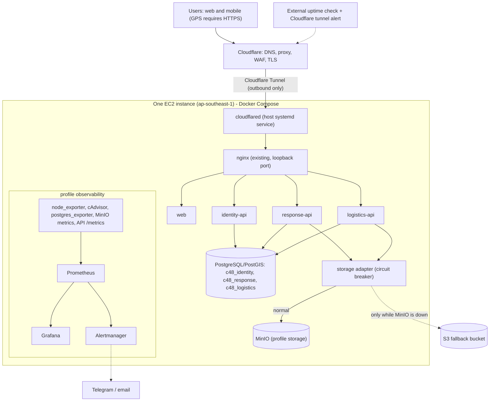

# Reliva Deployment and Operations Architecture (AWS single-host)

| Attribute | Value |
|---|---|
| Project | Reliva (original project code C48) |
| Status | **Proposal**, agreed in discussion with the user on 2026-11-22. Nothing here is implemented or benchmarked. |
| Scope | Where and how the existing Compose stack runs in production-like conditions: hosting, edge/TLS, object-storage failover, monitoring, backup, cost, rollout. |
| Out of scope | Application features, schema and API contracts (see `backend/README.md` and the technology plan). |
| Related | [Technology and delivery plan](c48-technology-and-delivery-plan.md) §14 (security/operations) and §15 (deployment baseline), `backend/infra/compose.yaml`, `backend/scripts/db/` (backup, restore, object inventory). |

Labels used below follow the plan's convention: **Decision** (confirmed by the user), **Proposal** (recommended, not yet confirmed), **Needs confirmation** (open question or unverified fact).

## 1. Goals and constraints

**Decisions (user, 2026-11-22):**

- One AWS EC2 instance runs the whole stack. No EKS and no second application host.
- Domain is already registered at Cloudflare; Cloudflare provides DNS, proxy and TLS.
- **No AWS Lambda.**
- Amazon S3 is used **only when MinIO fails**: new uploads go to S3 during the outage and are copied back to MinIO when it recovers. Files stored only in MinIO are accepted as unavailable during the outage. No scheduled S3 mirroring, to avoid extra cost.
- Monitoring (Grafana stack) runs on the same single host.
- Prefer low cost: the AWS credit (about USD 100) should last as long as possible.

**Invariants inherited from `AGENTS.md` (must not be broken):**

- `backend/infra/compose.yaml` is the only Compose file. New services use **profiles inside that file** (as `storage` already does for MinIO). No second Compose file, no test-only database or container.
- MinIO Community stays the primary object store, enabled only through the `storage` profile.
- Normal startup never removes volumes; reset only through the explicit `--reset` commands.
- Machine-readable contracts stay English and stable; every human-readable message shown to users stays Vietnamese. Operations dashboards and alert text are not product content, but they must not leak secrets or PII.

## 2. Target architecture

Key properties:

- **No inbound ports.** The security group opens nothing inbound; `cloudflared` makes outbound connections only, so the instance IP is not exposed. Administration uses AWS Systems Manager Session Manager instead of SSH.
- **Existing nginx stays the single ingress** (rate limits, SOS never-drop throttling, security headers from plan §14). The tunnel forwards to nginx's loopback port (`PUBLIC_HOST`/`PUBLIC_PORT`). `cloudflared` runs as a host service, so the Compose file does not gain a new container.
- PostgreSQL, MinIO, MinIO console and all exporters listen on loopback or the internal Compose network only.
- Grafana and Alertmanager are not routed through the public nginx. Reach them through an access-controlled tunnel hostname (Cloudflare Access) or an SSM port forward.

## 3. Compute and sizing

| Item | Proposal | Notes |
|---|---|---|
| Region | `ap-southeast-1` (Singapore) | Lowest latency to Vietnam among standard AWS regions. **Needs confirmation:** verify current latency and pricing. |
| Instance | `t3.medium` (2 vCPU, 4 GB), Ubuntu LTS | Upgrade to `t3.large` only if measured memory pressure appears. |
| Disk | gp3, 30–40 GB | Holds `c48_pgdata` and `c48_minio-data`. |
| Swap | 2 GB swap file | Safety margin for the monitoring stack on 4 GB. |
| Access | SSM Session Manager | No SSH port open. |

Memory is the constraint because monitoring shares the host. Keep monitoring lean: Prometheus + Grafana + Alertmanager + exporters, **no Loki** (read logs with `docker compose logs`). If memory is still tight, shorten Prometheus retention and scrape interval before resizing.

## 4. Edge, DNS and TLS (Cloudflare)

1. Create a Cloudflare Tunnel and install `cloudflared` on the instance as a systemd service.
2. Public hostnames (example): `app.<domain>` to the web/API ingress (nginx). Do **not** publish PostgreSQL, the MinIO console or the MinIO S3 port.
3. TLS terminates at Cloudflare; traffic to the instance is carried by the tunnel. HTTPS is mandatory because browser geolocation requires a secure context.
4. Keep the existing application-level throttling. Cloudflare proxying makes the real client IP arrive in a forwarded header, so nginx must be configured to trust that header only from the tunnel/loopback source; otherwise per-IP SOS limits would apply to the wrong address. **Needs confirmation** during implementation.
5. Protect operator hostnames (Grafana) with Cloudflare Access.

## 5. Object-storage failover (MinIO primary, S3 fallback)

### 5.1 Behaviour (Decision)

| Phase | Reads | Writes |
|---|---|---|
| Normal | From MinIO | To MinIO |
| MinIO down | Objects whose backend is `s3` are readable; objects only in MinIO are **temporarily unavailable** (accepted) | New objects go to S3 |
| Recovery | Both backends readable | New writes return to MinIO; a drain job moves S3 objects back |

Only S3 receives data during an outage. There is no scheduled mirror, so S3 normally holds nothing and costs almost nothing.

### 5.2 Design (Proposal)

- **Storage adapter** inside the shared backend storage code with a **circuit breaker**: after N consecutive MinIO failures or timeouts it opens (fallback mode); it periodically probes MinIO (half-open) and closes after a successful probe.
- **Location tracking:** each stored object records its backend (`minio` or `s3`). This needs a column on the evidence/attachment tables in `c48_response` and `c48_logistics` plus migrations, so reads know where to look. Schema and API contracts in `docs/backend/` take precedence; a contract change must be recorded there first.
- **Drain job (S3 to MinIO)** runs when the breaker closes. For each object: copy to MinIO, verify checksum, update the backend column, then delete the S3 copy. It is idempotent and resumable, and an interrupted run is safe to repeat. Run it inside the existing backend job boundary (no new service).
- **Failure edge cases to cover in the design review:** upload that fails midway on MinIO (retry once to S3 with the same idempotency key); object visible in both backends after a crash between copy and delete (reads prefer MinIO; the drain job reconciles); metadata committed but object missing; concurrent uploads during the breaker transition.
- **User-facing errors** for unavailable objects are Vietnamese messages with a stable English error code; clients branch on the code.
- The existing `object-inventory` tooling in `backend/scripts/db/` can verify that every database reference resolves to an object after recovery.

### 5.3 S3 bucket and IAM (Proposal)

- Private bucket, Block Public Access on, default encryption on, versioning off (the bucket should normally be empty).
- The instance uses an **IAM instance profile** scoped to this bucket only (put/get/delete/list). No long-lived access keys on the host.
- Lifecycle rule to expire stray objects after a safety period, plus an alert when the bucket is non-empty and the breaker is closed (indicates a stuck drain).
- Cost is negligible while the bucket is nearly empty; **Needs confirmation:** check current S3 pricing and request charges.

### 5.4 Testing without new infrastructure

Follow the Compose invariant: simulate the outage by **stopping and starting the main stack's MinIO container**, run the checks from the host against the main APIs and databases, and verify Vietnamese error messages and the drain result. Do not create a test-only MinIO, database or container.

## 6. Monitoring on the same host

### 6.1 Components (profile `observability` in `compose.yaml`)

| Component | Purpose |
|---|---|
| Prometheus | Scrape and store metrics (short retention) |
| Grafana | Dashboards |
| Alertmanager | Alert routing to Telegram or email |
| node_exporter | Host CPU, memory, disk, network |
| cAdvisor | Per-container usage |
| postgres_exporter | Connections, locks, database size |
| MinIO metrics | MinIO Prometheus endpoint (needs a scrape credential; keep it internal) |
| API `/metrics` | Request rate, errors and latency for each API (for example via `prom-client`); **Needs confirmation:** the APIs do not necessarily expose this today; the endpoint must not be routed through the public nginx. |

### 6.2 Dashboards

- **Infrastructure:** CPU, memory, swap, disk, container restarts.
- **API golden signals** per service: request rate, 5xx ratio, p95/p99 latency.
- **PostgreSQL:** connections vs limit, lock waits, slow queries, database size.
- **Object storage:** MinIO up/down, capacity, breaker state, S3 fallback object count, drain backlog.
- **Domain metrics (demo value):** new SOS count, time waiting for verification, active missions.
- **Backup:** age of the last successful backup.

### 6.3 Alerts

Disk above 80%, memory pressure or swap use, API 5xx ratio spike, database connections near limit, **MinIO down**, **S3 fallback non-empty after recovery**, backup too old, container restart loops.

### 6.4 Limitation and the external layer

Monitoring on the same host cannot report that the host itself died. Add two independent external signals at no cost:

1. **Cloudflare Tunnel Health Alert** (email/webhook): reports the tunnel as Down/Degraded when the host or `cloudflared` stops. Cloudflare documents it for Zero Trust plans; **Needs confirmation** that the Free plan includes it.
2. **External uptime check** calling `GET /health/live` through the public domain. The route exists in the backend. UptimeRobot's free plan (checked 2026-11-22) offers 50 monitors at a 5-minute interval; Better Stack's free plan offers 10 monitors at 3 minutes with Slack/email alerts. Free-plan terms (including commercial-use wording) change, so re-read them before relying on them. Detection takes roughly 3–5 minutes.

Health endpoints must return minimal status only (no versions, credentials or internal addresses).

## 7. Backup and restore

The repository already contains backup/restore scripts (`backend/scripts/db/backup`, `restore`, `object-inventory.mjs`, `verify-minio-endpoint.mjs`) and a hardening note in `docs/backend/t18-hardening.md`. Reuse them rather than writing new ones.

| Data | Method | Where |
|---|---|---|
| PostgreSQL (3 databases) | Scheduled logical dump with the existing script | Copy off the instance (second location, for example an S3 prefix or the operator's machine) |
| MinIO objects | Existing object-inventory and backup flow | Same |
| Configuration | `.env.example` in Git; real secrets only on the host | Never committed |

A backup that has never been restored is not a backup: schedule a restore drill and record the result for the defense evidence. Backing up to S3 is separate from the failover bucket and is **not** the "S3 only when MinIO fails" path; it is a small, infrequent copy and **Needs confirmation** against the user's cost preference (a manual download to the operator's machine is the zero-cost alternative).

Estimates: **RTO** is hours (rebuild the instance, restore); **RPO** equals the interval between backups. These are single-host figures, not high availability, consistent with plan §14.

## 8. Security

- No inbound ports; SSM instead of SSH; IAM instance profile instead of access keys.
- Secrets only in the host `.env` (outside Git) or a secret store; rotate demo credentials before the defense.
- Cloudflare Access in front of Grafana and any operator UI.
- Keep Nginx hardening, CSP and never-drop SOS throttling from plan §14; verify the trusted client-IP configuration behind Cloudflare (section 4.4).
- Logs and metrics must not contain secrets, tracking codes, phone numbers or other PII; use stable English codes in technical logs.
- Set AWS Budgets alerts (for example USD 20, 50, 80) **before** creating resources, and enable MFA on the AWS root account and use a non-root user for daily work.

## 9. Cost (estimates, verify before relying on them)

| Item | Approx. per month |
|---|---|
| EC2 `t3.medium` | ~USD 30 if running 24/7 |
| EBS gp3 30–40 GB | ~USD 3–4 |
| Public IPv4 / data transfer | a few USD |
| S3 fallback | near zero while empty |
| Cloudflare Tunnel, DNS, free alerts | USD 0 |

Roughly USD 35–40/month, so the credit lasts about two to three months of continuous running, longer if the instance is stopped when idle (stopped instances still pay for EBS). Avoid NAT Gateway, ALB, RDS and EKS unless there is a specific learning goal; each can cost more than the instance. **Needs confirmation:** all prices and the account's credit terms against the AWS pricing pages and calculator.

## 10. Kubernetes as a learning track (not production)

Production demo runs on Compose. Kubernetes is a time-boxed learning extension:

- Write manifests or a Helm chart for web and the three APIs and run them on a **local kind/k3d cluster**; PostgreSQL stays outside the cluster (the Compose database) or runs as a lab-only StatefulSet.
- Demonstrate rolling update, probes, resource limits, autoscaling and a failure drill; record short evidence for the defense.
- Optional: k3s on a second small EC2 only on demo days. EKS is not used (its control plane alone is a recurring charge).
- Manifests live in a separate directory and do not replace `compose.yaml`. If the team wants them inside this repository, record that as a scope decision in the plan.

Compose does not provide multi-host scheduling or high availability. For the defense, describe the migration path to Kubernetes/ECS (multiple replicas across availability zones, managed database, tiered network) as future work.

## 11. Rollout plan

1. AWS account: MFA, non-root user, Budgets alerts, region `ap-southeast-1`.
2. Create the EC2 instance (SSM enabled, no inbound rules), install Docker, add swap.
3. Deploy the existing Compose stack with `storage` profile; run migrations and demo seed through the declared jobs.
4. Install `cloudflared`, attach the tunnel to the nginx loopback port, verify HTTPS and GPS from a phone.
5. Enable the external uptime check and the Tunnel Health Alert.
6. Add the `observability` profile (Prometheus, Grafana, exporters, Alertmanager); add API `/metrics`.
7. Implement the storage adapter, location column, drain job and S3 bucket/IAM; run the MinIO stop/start drill.
8. Schedule backups and perform one restore drill.
9. Optional: CI/CD deploy and the Kubernetes learning track.

## 12. Open decisions

| # | Question | Default if not answered |
|---|---|---|
| 1 | Backups: off-instance copy to S3 (small cost) or manual download? | Manual download to the operator machine |
| 2 | Add a `storage_backend` column (schema/API contract change) in `docs/backend/`? | Yes, required for the failover design |
| 3 | Do APIs already expose metrics? If not, add `/metrics` internal-only | Add internal-only |
| 4 | Telegram vs email for Alertmanager | Telegram for host alerts; email for external checks |
| 5 | Resize to `t3.large` | Only if measured memory pressure |
| 6 | Kubernetes manifests inside this repository | Keep local/learning only until decided |

## 13. Sources checked on 2026-11-22

- [UptimeRobot Pricing](https://uptimerobot.com/pricing.md) and [free plan limits (2026)](https://dev.to/r0tten0x/uptimerobot-free-plan-in-2026-the-limits-thatll-actually-bite-you-445g)
- [Better Stack Uptime pricing](https://betterstack.com/uptime/pricing) and [Better Stack vs UptimeRobot](https://betterstack.com/community/comparisons/better-stack-vs-uptimerobot/)
- [Cloudflare Tunnel notifications](https://developers.cloudflare.com/cloudflare-one/networks/connectors/cloudflare-tunnel/monitor-tunnels/notifications)

AWS, Cloudflare and uptime-service limits and prices were not re-verified beyond the items above; confirm them from primary sources before implementation, as required by the project's working conventions.
