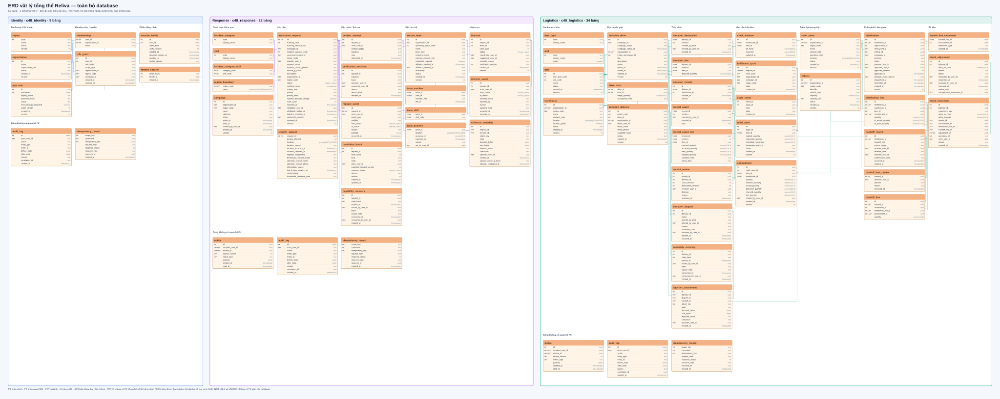
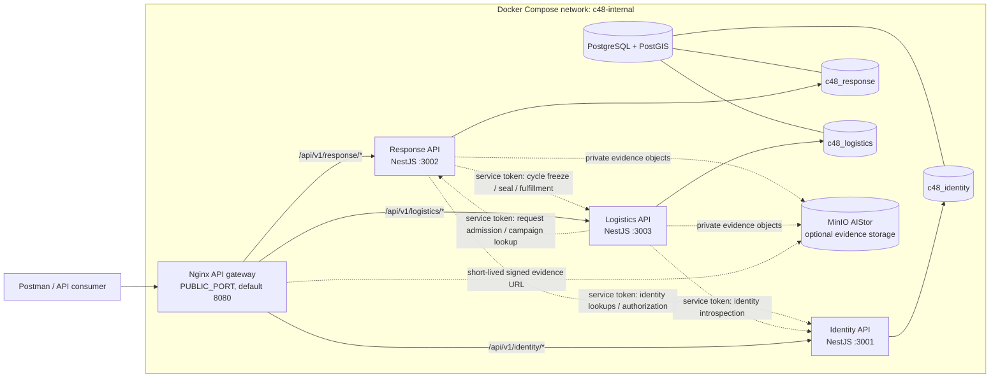
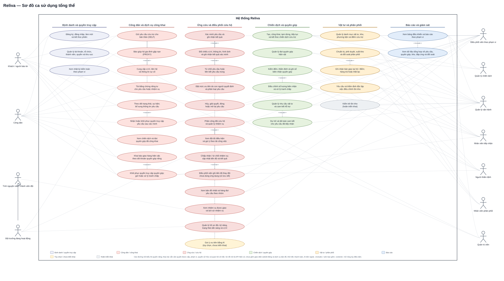
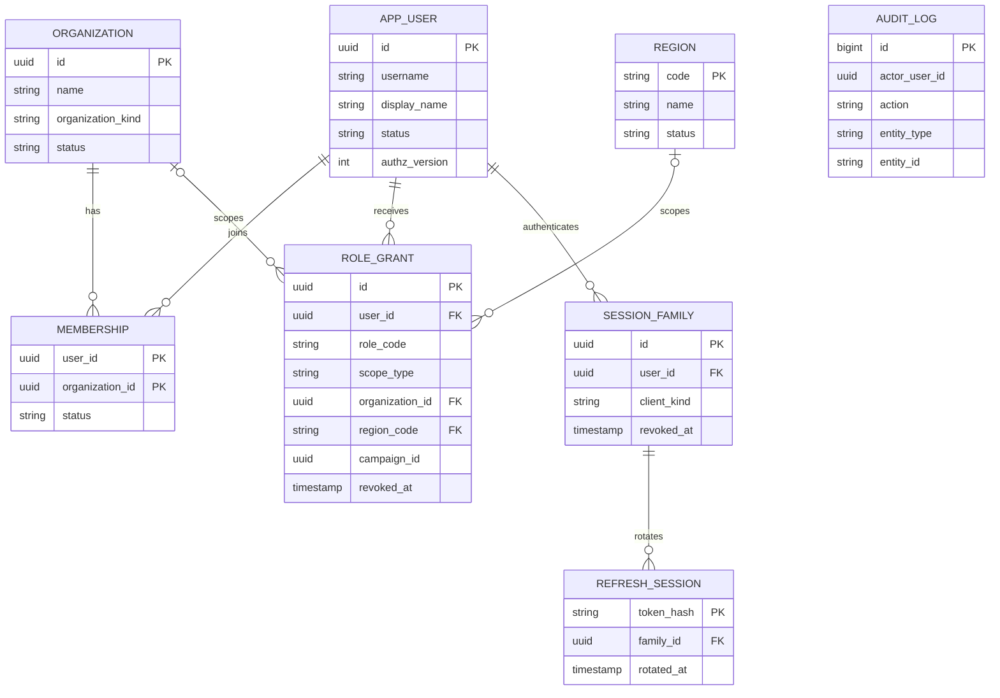
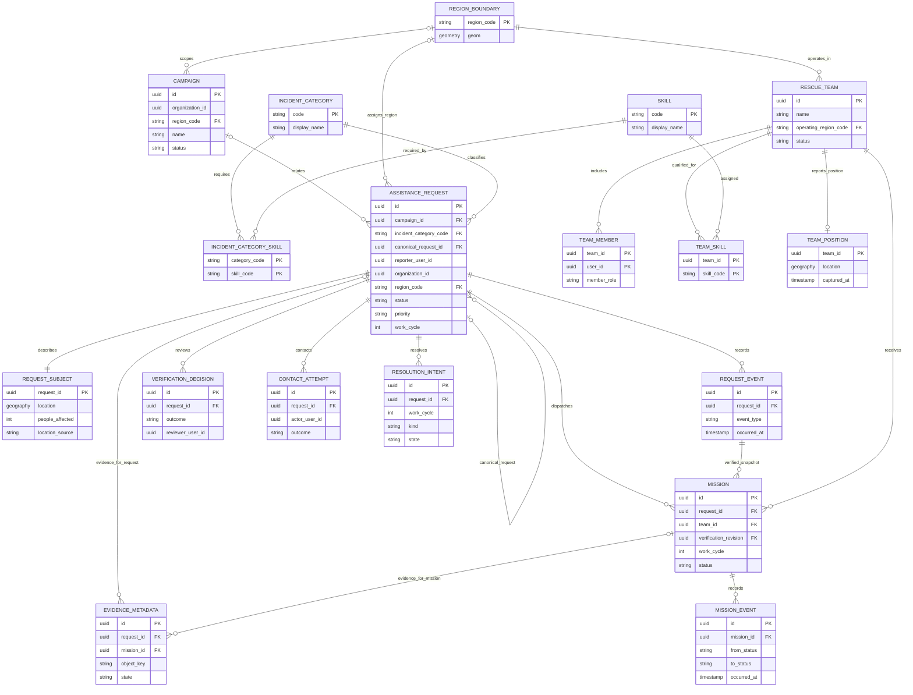
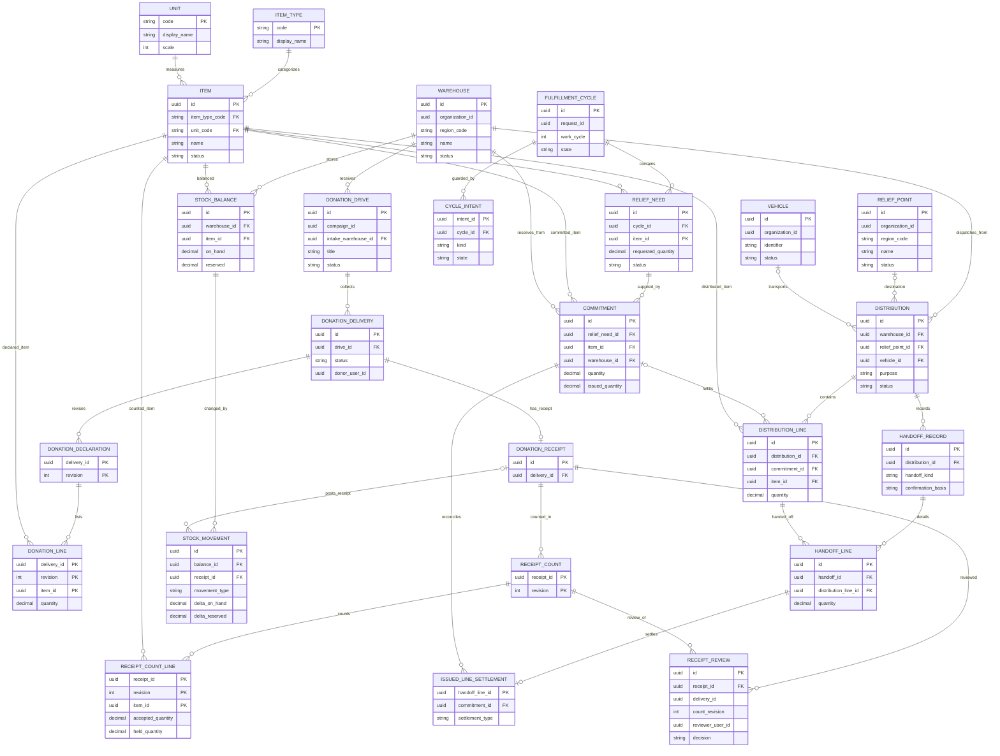

# Reliva Implemented System Diagrams

The diagrams here summarize the backend that is present in this repository. They describe current API and database behavior; they are not a claim that every planned Web or Mobile screen has been built.

Sources of truth:

- [Backend implementation status](../backend/README.md)
- [Role and permission map](../backend/05-permissions.md)
- [Identity schema](../backend/schema/identity.sql)
- [Response schema](../backend/schema/response.sql)
- [Logistics schema](../backend/schema/logistics.sql)
- [OpenAPI contracts](../../contracts/openapi/)
- [Compose stack](../../backend/infra/compose.yaml)
- [Nginx gateway](../../backend/infra/nginx/nginx.conf)

The ERD in the reference image includes entities such as `PaymentTransaction` and `CampaignHousehold`; those are not tables in the current physical schemas. The ERDs below show the actual service-owned tables and selected core relationships. Cross-service IDs such as `user_id`, `campaign_id`, and `request_id` are opaque references, not cross-database foreign keys.

## Complete physical ERD decomposition



[Editable full physical ERD](erd/c48-erd-physical-overall.drawio) · [All seven diagrams and previews](erd/README.md)

The full model shows all 65 tables, columns, SQL types, key markers, and declared local foreign keys. The six detail views cover the same tables at a more readable scale; gray boxes point to a same-service table detailed on another page. `REF` identifies an ID without a declared FK. The older sections below remain compact core-flow views; use the ERD set for the complete physical schema.

## 1. Runtime architecture and service connections



The public API is routed through Nginx by service prefix. The service ports are published on loopback in the local Compose stack for host-side checks; internal service calls use the Compose network and scoped service tokens. Health and internal endpoints are blocked at the public Nginx boundary. MinIO is an optional dependency for evidence storage.

## 2. Overall use-case diagram



[Mở nguồn Draw.io để chỉnh sửa](./c48-overall-use-cases.drawio). Sơ đồ tổng hợp các luồng backend theo sáu nhóm; mỗi hình bầu dục ghi tên chức năng, không chèn mã yêu cầu. Gợi ý AI là tùy chọn, kiểm kê tồn kho đang hoãn triển khai. Ba sơ đồ theo lĩnh vực trong kế hoạch dự án là các góc nhìn bổ trợ.

## 3. Assistance request and rescue mission flow

```mermaid
sequenceDiagram
  autonumber
  actor Reporter as Guest or citizen
  actor Coordinator
  actor Volunteer as Assigned team leader
  participant Nginx as Nginx gateway
  participant Response as Response API
  participant Identity as Identity API
  participant RDB as Response database
  participant Logistics as Logistics API

  Reporter->>Nginx: POST /api/v1/response/requests (SELF)
  Nginx->>Response: Forward request
  opt Signed-in reporter
    Response->>Identity: Validate session / user when required
    Identity-->>Response: Active user and grants
  end
  Response->>RDB: Store request + subject/location + initial event atomically
  Response-->>Reporter: Request ID + tracking capability

  Reporter->>Nginx: GET /api/v1/response/requests/track
  Nginx->>Response: Forward tracking-code / secret request
  Response->>RDB: Read reporter-visible request projection and events
  Response-->>Reporter: Current status and permitted timeline

  Coordinator->>Nginx: Read queue; verify / reject / mark duplicate
  Nginx->>Response: Forward scoped coordinator command
  Response->>Identity: Introspect actor and live grants
  Identity-->>Response: Grants and scope
  Response->>RDB: Save decision, verification snapshot, and event

  Coordinator->>Nginx: Triage with human priority; assign team mission
  Nginx->>Response: Forward scoped assignment command
  Response->>RDB: Save priority, mission offer, and audit/event data
  Volunteer->>Nginx: Read own missions; accept / decline / update status
  Nginx->>Response: Forward leader-authorized command
  Response->>RDB: Save mission event and request status

  opt Evidence upload is configured
    Volunteer->>Nginx: Upload mission evidence
    Nginx->>Response: Validate and stage evidence
    Response-->>Volunteer: Evidence metadata / upload result
  end

  Coordinator->>Nginx: Resolve request
  Nginx->>Response: Forward resolve command
  opt Request has been admitted to Logistics
    Response->>Logistics: GET internal fulfillment for the current work cycle
    Logistics-->>Response: Fulfillment evidence for current work cycle
  end
  Response->>RDB: Create pending resolution intent; move request to RESOLVING
  opt Request has been admitted to Logistics
    Response->>Logistics: POST cycle seal for resolution intent
    Logistics-->>Response: Seal accepted
  end
  alt Finalizer completes
    Response->>RDB: Mark intent complete; set RESOLVED and append event
  else Upstream failure or finalization deferred
    Response->>RDB: Keep intent pending for recovery
  end
  Response-->>Coordinator: 202 Accepted; resolution operation ID and state
```

Verification, priority, team assignment, and resolution are human-controlled. Resolution coordinates with Logistics only when that request was admitted there; the no-Logistics-admission path does not require a Logistics seal.

## 4. Donation, stock, and relief distribution flow

```mermaid
flowchart LR
  Donor["Guest / citizen donor"] -->|"Browse public drives; declare item delivery"| Drive["Donation drive + delivery declaration"]
  Drive --> Intake["Intake staff count goods"]
  Intake --> Review["Independent reviewer checks count"]
  Review -->|"Approve and post"| Receipt["Donation receipt"]
  Receipt --> Movement["Append stock movement"]
  Movement --> Balance["Warehouse stock balance"]

  Coordinator["Coordinator / operations manager"] --> NeedCommand["Submit relief need command"]
  NeedCommand --> Admission["Response API admits request + work cycle"]
  Admission --> Cycle["Logistics fulfillment cycle"]
  Cycle --> Need["Persist relief need"]
  Cycle --> Commitment["Reserve item quantity from warehouse"]
  Balance --> Commitment
  Commitment --> Distribution["Prepare distribution"]
  Distribution --> Approve["Independent approval"]
  Approve --> Dispatch["Dispatch stock"]
  Dispatch --> Handoff["Record delivery / point receipt / handout"]
  Handoff --> Settlement["Settle delivered, returned, or approved loss"]
  Settlement --> Reconcile["Reconcile fulfillment and stock ledger"]
```



Public donations represent goods delivered to a drive. The implemented schema and API do not contain a cash payment transaction. Stock changes are represented by append-only `stock_movement` rows; the service/database updates the derived balance.

## 5. Identity physical ERD (core)



`ROLE_GRANT.campaign_id` is an opaque Response campaign ID and has no foreign key to the Response database. The audit actor ID is not an FK. `ROLE_GRANT.organization_id` / `region_code` scope grants; the role catalog and role-to-permission rules are enforced by application code and database checks.

## 6. Response physical ERD (core)



`EVIDENCE_METADATA` must belong to exactly one request or mission. User and organization IDs are owned by Identity and intentionally have no cross-service foreign keys.

## 7. Logistics physical ERD (core)



This is a core view, not every Logistics table. Donation disputes, attachments, stock adjustment review, and additional stock movement links are omitted to keep the ERD readable. `request_id`, `campaign_id`, `organization_id`, and user IDs are opaque references owned by other services where applicable.

## Deliberately not represented as implemented

- No Web or Mobile screen code is present in this workspace, so a screen-by-screen navigation diagram cannot be derived from implementation.
- Volunteer assignment is represented through scoped role grants and team membership; no self-service volunteer application screen or API is shown here.
- The current backend models in-kind donation deliveries and stock receipts; it has no cash checkout or `PaymentTransaction` table.
- No external weather-service integration or AI/LLM dispatch endpoint is represented. Request verification, priority, assignment, and dispatch remain human-controlled.
- These ERDs are intentionally simplified core views. Use the linked SQL files for the complete physical schema and constraints.
